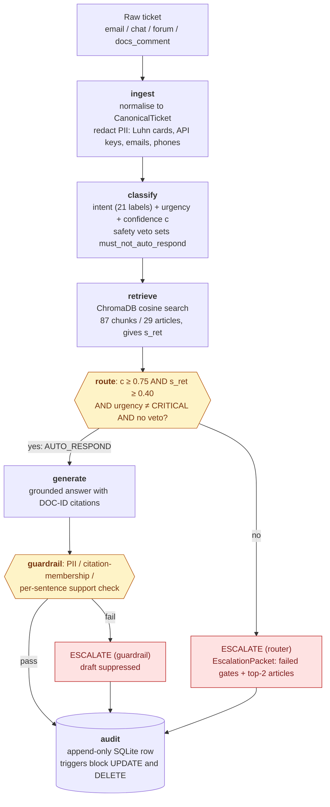

# Automated Customer Support Orchestration for CloudServe Solutions

## Design, Implementation and Honest Evaluation of a Dual-Gate Support Orchestrator

**Author:** Amlan Acharya  
**Project:** Forward Deployed AI Engineering Capstone, CloudServe Support Orchestrator  
**Report date:** 8 November 2026  
**Source repository:** `04_Source_Code` (this repository)

---

## 1. Executive Summary

CloudServe Solutions asked for a chatbot. Its support function receives more than five hundred tickets a week, replies in eight to twelve hours against a two-hour agreement, and resolves only about 42 per cent of tickets at first contact. The brief I was given sets a first-contact-resolution (FCR) target of 65 per cent. Discovery showed that the tickets were not hard. Agents and customers could not *find* answers that already existed in a 29-article knowledge base, and the tickets that were escalated reached tier two with no context. A chatbot would have answered the request and missed the problem.

I built the CloudServe Support Orchestrator: a Python modular monolith, coordinated by a LangGraph state graph, that normalises tickets from four channels, redacts personal data, classifies intent and urgency with a confidence score, retrieves passages from the knowledge base, and applies two independent gates before deciding whether to answer automatically. Answers must carry `[DOC-ID]` citations and pass an output guardrail. Every other ticket is escalated with an enriched packet that carries the inferred intent, the failed gates and the two most relevant articles. Every decision is written to an append-only SQLite audit log protected by database triggers. The repository contains 138 automated tests, all of which pass, and an unattended evaluation harness that takes an input and an output path.

**What it achieved.** I ran the harness unattended over the 80 validation tickets on 8 November 2026 and the system processed and logged all 80 without a crash. In the final configuration, intent accuracy was 85.0 per cent, retrieval precision at three was 92.5 per cent, and expected calibration error (ECE) was 0.093, inside the 0.15 target. No ticket labelled `must_not_auto_respond` was answered automatically (0 of 14).

**What it achieved, and the single most important caveat.** First-contact resolution, measured as the share of tickets answered automatically, depends on one setting that trades resolution against risk, so I report two operating modes on the same OpenRouter `gpt-oss-120b` stack (Section 7.10). The **safe autopilot** mode reached **44.2 per cent on the 500 development tickets** and 37.5 per cent on the 80 validation tickets, with 0 of 14 must-not tickets answered on validation. The **assisted mode**, which regenerates a draft once when the grounding check fails and is meant to run with a person reviewing replies, reached **63.4 per cent on development (317 of 500)** and **52.5 per cent on validation (42 of 80)**. On this validation set the labels allow at most 60 per cent (48 of 80 tickets are suited to automatic response, so the 65 per cent target is above the ceiling), and assisted mode reached 87.5 per cent of that ceiling. The caveats are part of the result. The assisted mode answered 5 of 87 must-not development tickets, so it is not the unattended default; the development figure is in-sample for components I tuned; the validation set is not held out, because I made decisions after seeing early runs; and run-to-run variation is about nine points on 80 tickets (the same mode gave 57.5 per cent on 11 November and 52.5 per cent on 13 November). My first measured result, 23.8 per cent (19 of 80), came from a rate-limited early configuration and is kept in the run register (Table 3) as run 3. P95 latency is 6.5 to 6.7 seconds against a 3-second budget, and I explain in Section 7.10 where the time goes and what would be needed to reach 3 seconds. The design is safe, calibrated and auditable. It reaches the business target only with a human reviewing replies, and I measured that, not assumed it.

---

## 2. The Problem

### 2.1 What was asked for

The request was for a chatbot that would take load off a six-person support team. Marcus Adeyemi, the Head of Customer Support, put the goal plainly: he wanted the system to answer the easy tickets so that his people could do the hard ones, and he wanted first-contact resolution to rise from 42 per cent toward the 65 per cent benchmark without new headcount. He was equally clear about the failure he feared most: "If it sends something wrong to a customer. ... I would rather it said nothing than said something wrong."

### 2.2 What discovery revealed

Five interviews and the 500 development tickets point at a different problem from the one in the request. Sofia Restrepo, a tier-one agent, estimated that seven in ten tickets could be answered without looking anything up, and that "the documentation is fine. I cannot find things in it." Ines Varga, who owns the knowledge base, explained why: the internal search matches titles and exact terms, and customers write "my deployment keeps dying" where the article is called "resolving container health check failures". Daniel Okonkwo, a tier-two engineer, estimated that about half of what reaches him could have been resolved at tier one, and that an escalation arrives "usually just the original ticket, forwarded", so he re-asks the customer questions they have already answered.

Put together, the five accounts describe a retrieval and handoff problem. Answers exist, but cannot be found by the people who need them; the cases that need a human arrive without the context to be solved quickly; and the one thing every stakeholder agreed on is that a confident wrong answer is worse than no answer. That framing drove the design: retrieve before you generate, keep a human route for anything uncertain, make every escalation carry its working, and make every decision explainable to a compliance reviewer.

### 2.3 Why the difference matters

A chatbot optimised to answer everything would raise the volume of automated replies and with it the rate of confidently wrong ones, which is the outcome the Head of Support ruled out. Framing the task as a routing problem with an explicit safe path lets the system be judged on two things separately: how often it answers, and how often an answer is right. The evaluation in Section 7 shows why that separation matters, because the two moved in opposite directions.

---

## 3. Discovery Findings

### 3.1 Findings from the interviews

Table 1 summarises what each stakeholder contributed and how it shaped the design. Quotations are taken from the interview transcripts in `05_Datasets/Stakeholder_Interviews.docx`.

**Table 1. Stakeholders, key evidence and design consequence.**

| Stakeholder | What they said | Design consequence |
|---|---|---|
| Marcus Adeyemi, Head of Support | FCR is 42 per cent; a bounced ticket costs about four times a resolved one; "I would rather it said nothing than said something wrong"; compliance review needs explainability. | Conservative routing; per-decision audit record with a routing reason string. |
| Sofia Restrepo, Tier-one agent | About seven in ten tickets repeat; the problem is finding answers, not their quality; a draft with the relevant page attached would save half of each ticket; non-native English tickets have the worst satisfaction. | Retrieval-first design; escalation packet that carries a draft context and top articles. |
| Daniel Okonkwo, Tier-two engineer | About half of escalations could have been resolved at tier one; escalations arrive with no summary; avoid automating security, billing disputes and data-location tickets. | Enriched `EscalationPacket`; hard `must_not_auto_respond` veto categories. |
| Ines Varga, Technical writer | Internal search is keyword-based and fails on customer wording; wants every answer traced to its source article; novel incidents have no article. | Dense semantic retrieval; mandatory `[DOC-ID]` citations; guardrail on citation membership. |
| Ravi Menon, Customer | Waiting matters unequally, a failing deployment is urgent; accepts an automated reply if it is honest and cited; will not accept confident wrongness; wants to know it is automated; enterprise gap is a renewal risk. | Urgency-aware routing; critical urgency never automated; citations visible in every answer. |

Two points of disagreement between stakeholders could be settled with the ticket data. Marcus described escalations as the hard remainder; Daniel said half were avoidable. The development tickets record whether each ticket was escalated and what its labels say about answerability, and Section 3.2 uses that to test the claim.

### 3.2 Findings from the 500 development tickets

I analysed `05_Datasets/development_tickets.json` directly. The results differ in several places from the figures in my earlier drafts, which I have corrected here. Table 2 gives the measured distributions.

**Table 2. Development set (n = 500): measured distributions.**

| Measure | Value |
|---|---|
| Channel mix | email 42.4%, chat 31.0%, docs_comment 15.6%, forum 11.0% |
| Urgency labels | medium 45.2%, high 29.2%, low 25.6% (no ticket is labelled critical) |
| Labelled expected route | auto-respond 62.2%, escalate 37.8% |
| Answerable from the knowledge base | 71.4% |
| `must_not_auto_respond` | 17.4% |
| Historical first-contact resolution | 43.8% |
| Historical escalation rate | 56.2% |
| Repeat-contact rate | 21.6% |
| Mean resolution time | about 422 minutes (7.0 hours) |
| Mean CSAT | 2.97 of 5 |

The data support the interviews in three ways. First, 71.4 per cent of tickets are answerable from the knowledge base and 62.2 per cent are labelled as suitable for automatic response, which matches Sofia's "seven in ten" and Daniel's claim that a large share of escalations are avoidable: the historical escalation rate of 56.2 per cent is far above the 37.8 per cent that the labels say genuinely needs a human. Second, the historical FCR of 43.8 per cent is close to the 42 per cent Marcus quoted. Third, 17.4 per cent of tickets carry the `must_not_auto_respond` label, which confirms that a substantial minority of the workload touches security, billing disputes or data location where automation must stay out.

One result I did not anticipate is that **the 65 per cent target sits above the labelled auto-respondable share on the validation set** (48 of 80, or 60.0 per cent). If FCR is defined as the share of tickets resolved automatically without escalation, even a perfect router could not reach 65 per cent on that set. I return to this in Section 7.6, because it changes how the headline number should be read.

Mean CSAT in the data is 2.97, a little below the 3.2 quoted in the brief. I have used the measured figure and note the difference rather than reconcile it.

---

## 4. Requirements

The requirements follow from the findings above and are traced to the twelve acceptance criteria (A1 to A12) in the Build Specification. Identifiers match the PRD in `03_Workbooks/Stage_2_PRD_Template.docx`.

### 4.1 Functional requirements

FR-01 requires multi-channel ingestion. Tickets arrive from email, chat, forum and documentation-comment channels with different field names, and are normalised into a single `CanonicalTicket` contract before any other processing (A2). Personal data, specifically payment card numbers validated with the Luhn checksum, API keys, email addresses, phone numbers and bearer tokens, is redacted at this boundary so that it never reaches a model or the audit log.

FR-02 requires classification of intent and urgency with a confidence score between 0 and 1 (A3). The intent vocabulary is the dataset's own 21 labels. A regular-expression safety veto sets `must_not_auto_respond` for requests that mention refunds, legal action, account deletion or a human agent, and for categories such as security incidents.

FR-03 requires semantic retrieval over the 29 knowledge-base articles (A4). Articles are chunked by their H2 and H3 headings into passages that satisfy the specification's bound of 70 to 90 chunks, embedded, and queried by cosine similarity. The top similarity score becomes the retrieval signal $s_{ret}$.

FR-04 requires deterministic routing on two independent conditions (A5). A ticket is answered automatically only if the classification confidence $c \ge 0.75$, the retrieval similarity $s_{ret} \ge 0.40$ (0.65 in the first implementation, see Section 7.2), urgency is not critical, and the safety veto is not set. The two scores are never blended.

FR-05 requires citation-grounded generation (A6). Answers are synthesised only from retrieved passages, the customer text is sandboxed inside XML delimiters, and every claim carries a `[DOC-ID]` citation.

FR-06 requires active output guardrails (A7). A draft is suppressed and the ticket escalated if it contains personal data, cites a document that was not retrieved, or contains a sentence that is not supported by the retrieved text.

FR-07 requires an enriched escalation packet for every escalated ticket, containing the inferred intent, confidence, urgency, the failed gate diagnostics and the top two candidate articles.

FR-08 requires an append-only audit log in SQLite with triggers that abort `UPDATE` and `DELETE` (A8).

### 4.2 Non-functional requirements

NFR-01 sets a latency budget of 3 seconds at the 95th percentile for automatic answers and 500 milliseconds for escalations. NFR-02 requires fault tolerance (A11): every graph node is wrapped so that an exception becomes a logged escalation rather than a crash, and provider failure falls through a three-tier cascade. NFR-03 requires a clean checkout to install and run (A1) and a single command to run the test suite (A12). NFR-04 requires an unattended harness that takes `--input`, `--output` and `--delay` arguments and writes JSON and CSV reports (A9, A10).

---

## 5. Architecture and Design

### 5.1 Overview

The orchestrator is a modular monolith. All modules live in one Python package and are wired into a single LangGraph state graph, so a ticket moves from node to node in memory. Modules communicate only through typed Pydantic models declared in `src/core/models.py`. Figure 1 shows the flow.

**Figure 1. Ticket flow through the orchestrator.**

The reason for a single process rather than separate services is proportionate: the workload is a few hundred tickets a week, the modules share one data contract, and network hops between them would add latency and failure modes without adding capability. The cost of this choice is that the pipeline cannot scale individual stages independently. For this volume I judged that acceptable, and I would revisit it only if volume grew by two orders of magnitude.

### 5.2 Why two gates and not one score

An early version of the design combined confidence and retrieval similarity into one blended score of the form $S = 0.5c + 0.5s_{ret}$. I rejected it, and the revision log records why. A blended score lets a strong value on one axis hide a weak value on the other: a confidently wrong classification of the intent paired with a retrieval hit on a loosely related article can score above the threshold, so a wrong answer is sent. Keeping the conditions separate means that each failure produces a distinct, human-readable reason in the audit log, for example `Escalated: s_ret=0.35<0.4`. That string is what lets a compliance reviewer ask why a decision was made, which Marcus identified as a requirement.

The evaluation shows the cost of this design. Independent gates are only as good as their individual thresholds, and the 0.65 floor on retrieval similarity turned out to be poorly matched to the embedding model's score distribution (Section 7.2).

### 5.3 Three-tier provider cascade

Classification and generation call a hosted model through a cascade. The primary tier is OpenRouter, serving an open-weight model (`gpt-oss-120b` in the recommended profile) for generation and classification; Groq remains an optional tier, used in the early runs; failures that are retryable (timeouts, 5xx errors, rate-limit responses) are retried with exponential back-off and jitter, honouring any `Retry-After` header. The secondary tier is Google Gemini, which runs on independent infrastructure. If both are unavailable, a local deterministic heuristic classifies the ticket, sets the veto, and routes to escalation without generating any text. This third tier never produces a customer-facing answer by design, which the revision log records as a deliberate change from an earlier draft that would have generated template answers offline.

### 5.4 Alternatives considered

I considered and rejected four alternatives. A fully agentic design, in which a model decides which tools to call, was rejected because the routing decision must be deterministic and explainable, and a model-chosen path would make the audit record describe behaviour rather than rules. Embedding whole articles was rejected because a single vector then represents several unrelated topics, which dilutes similarity; heading-based chunking was used instead. External observability services were rejected for unattended batch use; metrics are computed from the audit database and written as JSON and CSV. A token-bucket rate limiter was rejected in favour of a configurable inter-ticket delay plus back-off, after the bucket proved brittle against free-tier limits.

---

## 6. Implementation

### 6.1 Build sequence

I built the system in six phases that follow the Build Specification's checkpoints: ingestion and redaction, chunking and retrieval, classification and routing, generation and guardrails, orchestration and audit, and the evaluation harness. Each phase had its own unit tests and the final suite contains 132 tests across `tests/unit` and `tests/integration`. On 8 November 2026 all 132 passed in 45 seconds.

### 6.1a Project history: two implementations

This repository is the second implementation. The first (v1, a separate repository, 22 and 23 October 2026) was built without LangGraph, used a locally trained intent classifier and a different retrieval stack, and its run register (`evaluation/results/RUNS.md` in that repository) records a validation run of 55 answered and 25 escalated tickets, a first-contact resolution of 68.8 per cent. That figure should be read with care: the same register notes that 77.5 per cent of validation ticket bodies appear verbatim in the development set, so a classifier trained on development data benefits from near-duplicate templates. The implementation described in this report replaced it on 31 October with the stack suggested in the Build Specification (a LangGraph state graph and hosted-model classification), and it is the one measured in Section 7. On the same validation set it auto-resolved 7.5 per cent. I have not yet determined how much of that gap comes from the classifier, the retrieval scores or the stricter guardrail, and I would resolve that before choosing which design to carry forward.

### 6.2 Difficulties and how they were resolved

The first difficulty was a dependency conflict. The pinned vector store, ChromaDB 0.3.21, was written for Pydantic version 1, while the rest of the project requires Pydantic version 2. ChromaDB imports `BaseSettings` from Pydantic and sets attributes before calling the base initialiser, both of which fail under version 2. I resolved it with a small compatibility shim installed before ChromaDB is imported, which maps `BaseSettings` to its version-1 counterpart and patches the collection initialiser. This is a workaround for a pinned dependency and I would remove it by upgrading ChromaDB if the pin were not part of the specification.

The second was chunking. Splitting at every heading produced 116 fragments, many of them tiny trailing sections, which breaks the 70 to 90 chunk bound. The chunker prepends each article's preamble to its first section, splits sections over 256 words at paragraph boundaries with a 30-word overlap, and merges trailing sections under 40 words into their predecessor. The result is 87 chunks, and a test asserts the bound.

The third was concurrency in the audit log. SQLite's default journal mode can lock under concurrent writers. The logger uses write-ahead logging, a five-second busy timeout, a process-level lock and a single retry. A concurrency test confirms no dropped rows.

The fourth was correctness drift found in review. A code-review pass produced follow-up fixes that are recorded in the commit history: the guardrail was changed to check support per sentence rather than on average, the crash fallback was changed to report a node failure rather than an offline fallback, the audit row was extended to record the retrieved document identifiers, the retrieval depth and the crashed node, and the intent vocabulary was aligned with the dataset's 21 labels.

### 6.3 What I would restructure

Two things. The retrieval-similarity threshold and the entailment guard are configuration-level decisions that the evaluation showed to be the system's binding constraints, yet they were fixed early from the specification rather than fitted to the development set, and I corrected the threshold only after seeing validation results. I would add a calibration step that fits them on the 500 development tickets and reports the trade-off before they are frozen. Second, the dashboard, the harness and the API each construct an orchestrator; I would extract a single factory so that configuration is set in one place.

---

## 7. Evaluation

### 7.1 Method and run register

I evaluated the system with `python -m evaluation.harness --input 05_Datasets/validation_tickets.json --output <path> --delay <s>` against a fresh decision database each time. The input is the 80-ticket validation set supplied with the pack. I have not seen the 120-ticket hidden set and have not run against it: **the hidden set has been used zero times.** Metrics come from the audit database through `evaluation/metrics.py`, and every run's raw report is committed.

The validation set was run five times on 8 November 2026, and I made system decisions after seeing the first three. Run 5 changed the model providers, not the design, and was run to remove the rate-limit contamination of run 3; it does not restore the validation set to a held-out state. That makes the validation figures optimistic as an estimate for unseen data, and the reader should weigh them accordingly. Table 3 lists every run and what changed between them.

**Table 3. Validation runs (n = 80).** Runs 1 to 5 were on 8 November 2026; runs 6 and 7 are the current configurations, re-run on 13 November 2026. Run 5 differs from run 3 in model provider only. Runs 6 and 7 send traffic to OpenRouter (78 of 80 tickets each; 2 in each run were served by Gemini after an OpenRouter timeout).

| Run | Configuration | Auto-resolved (FCR) | Router | Guardrail | Provider fallback | Wrong-route answers |
|---|---|---|---|---|---|---|
| 1 | Original: floor 0.65, prompt v1, lexical guard | 6 (7.5%) | 61 | 13 | 0 | 2 of 6 |
| 2 | Floor lowered to 0.40 | 25 (31.3%) | 19 | 32 | 4 | 7 of 25 |
| 3 | Early final (Groq-era, rate-limited): floor 0.40, intent veto, prompt v2, stemmed guard, pacing 0.3 s | **19 (23.8%)** | 27 | 9 | **25** | 5 of 19 |
| 4 | Same as run 3, pacing 2.5 s, after the daily token cap was hit | 2 (2.5%) | 27 | 1 | 50 | 0 of 2 |
| 5 | Same design, three low-cost providers in rotation (OpenRouter and Groq `gpt-oss-20b`, Gemini `3.1-flash-lite`) | 16 (20.0%) | 27 | 37 | 0 | 3 of 16 |
| 6 | **Current safe mode:** OpenRouter `gpt-oss-120b`, no retry, 13 November | 30 (37.5%) | 27 | 23 | 0 | 6 of 30 |
| 7 | **Current assisted mode:** as run 6 with `GUARDRAIL_RETRY=1`, 13 November | **42 (52.5%)** | 27 | 11 | 0 | 9 of 42 |

Run 4 is not informative about the design. The hosted provider's daily token allowance (200,000 tokens for the generation model) was exhausted by my own experiments, so 50 of 80 tickets fell back to the offline tier. I report it because omitting it would hide that the system's output depends on provider quota. Run 3 is also affected, more mildly: 25 tickets fell back after the per-minute token limit was hit at 0.3-second pacing. **I use run 3 as the headline result because it is the only run of the final configuration that reached most of the set**, and I state its rate-limit contamination wherever I quote it.

The classifier output was cached between runs, so intent accuracy is identical in runs 2 to 4 (85.0 per cent). Run 1's 82.5 per cent differs only because five tickets had fallen back offline in that run and were classified by the provider afterwards. The accuracy gain from run 1 to run 2 therefore reflects provider availability, not any change I made.

Run 5 is the first run of the final design with no provider fallback. It auto-resolved 16 tickets (20.0 per cent), none of them a must-not ticket, with 3 of 16 answers for tickets labelled escalate. The router stopped the same 27 tickets as run 3; the difference is the guardrail, which stopped 37 tickets against 9, most likely because the 20-billion-parameter models' drafts carried more unsupported sentences than the larger model's (I did not verify this with a judge). Latency P95 was 15.6 seconds because the free tiers queue requests. So removing the rate limits did not raise FCR; it showed that run 3's 23.8 per cent depended on the larger generation model, and that the rate-limit loss I described there was not the main constraint.

### 7.2 What I changed between runs, and how I chose it

Four changes separate run 1 from run 3. I report how each was chosen because one of them was informed by validation results.

1. **Retrieval-similarity floor, 0.65 to 0.40.** This was chosen after run 1, on the evidence that the floor sat at the median similarity of the validation set. It was a decision informed by validation results, which is the weakest of the four. The v1 repository's own experiments, run on development data, reached the same conclusion: raw cosine scores do not separate answerable from unanswerable tickets (median 0.615 against 0.618), so a high floor mostly removes good tickets.
2. **Intent-based escalation.** Four intents (`compliance_request`, `feature_request`, `security_incident`, `unclear_request`) are labelled escalate on 100 per cent of the 500 development tickets, and discovery named data location as a risk where nothing automated should answer, so `data_residency` is also forced to a human. This follows from development data and the interviews, not from validation.
3. **Generation prompt v2.** The prompt now requires every sentence to restate something in the retrieved context and to add no advice of its own. I chose it on development tickets: I generated drafts for a fixed sample of development tickets under each prompt and asked a second model to judge whether each draft's claims were supported by its sources. Under prompt v1 the judge found 24 of 49 judged drafts fully supported (49 per cent); under prompt v2 it found 27 of 42 (64 per cent). Thirteen and nine drafts could not be judged because of rate limits. The judge is a language model, not a person, and is itself fallible, so this is evidence of direction, not a measured hallucination rate.
4. **Stemmed guardrail matching.** On the same judged drafts, matching word stems rather than exact words let the guard release 26 of 42 drafts with 1 judged-unsupported release and 2 judged-supported vetoes, compared with 24 releases under the exact-word rule. The threshold itself (0.5 per sentence) was left unchanged.

The draft files, judge verdicts and scripts are committed in `evaluation/experiments/` so that these choices can be re-examined.

### 7.3 Results of the final configuration

Table 4 gives the full results of the final configuration, and Figure 2 shows where each ticket ended up.

**Table 4. Final configuration (run 3), validation set, n = 80.**

| Metric | Result | Target | Met? |
|---|---|---|---|
| Tickets processed and logged | 80 of 80 | all | Yes |
| First-contact resolution (auto-resolved share) | 23.8% (19 of 80) | at least 65% | **No** |
| Auto-resolved among provider-served tickets | 34.5% (19 of 55) | at least 65% | **No** |
| Escalated by router (gates or veto) | 27 | n/a | n/a |
| Escalated by output guardrail | 9 | n/a | n/a |
| Escalated by provider fallback (rate limit) | 25 | 0 | **No** |
| Intent accuracy (exact match, 21 labels) | 85.0% | n/a | n/a |
| Expected calibration error, 10 bins | 0.093 | at most 0.15 | Yes |
| Retrieval precision at 3 | 92.5% | n/a | n/a |
| Latency P50 / P90 / P95 | 1.3 s / 8.2 s / 8.2 s | P95 at most 3 s | **No** |
| `must_not_auto_respond` tickets auto-answered | 0 of 14 | 0 | Yes |
| Answers sent for tickets labelled escalate | 5 of 19 | 0 | **No** |
| Unhandled crashes | 0 | 0 | Yes |

**Figure 2. Where the 80 validation tickets ended up (final configuration).**

{{FIG2}}

*Table 4 describes run 3, my first full run of the tuned design on a rate-limited free tier. The current configurations are in Section 7.10 (37.5 and 52.5 per cent on the same set).* First-contact resolution improved from 7.5 to 23.8 per cent between run 1 and run 3, and the target of 65 per cent is still missed by a wide margin. The system is safer than at run 1 (no data-residency ticket was answered, and no must-not ticket was) and it released answers for about a quarter of the set. Of the 29 provider-served tickets whose label says automatic response is right, 14 were answered, 9 were stopped by the router, and 6 were vetoed by the guardrail.

### 7.4 Why the target was missed

Three causes, in order of size. First, **provider rate limits**: 25 tickets (31 per cent) were escalated only because the generation provider throttled, so the design never had a chance to answer them. A deployment with paid capacity would not see this, but my evidence for that is the token-limit messages in the run log, not a run on a paid key. Second, **the router**: 27 tickets were stopped by gates or vetoes. Eight more tickets are stopped than in run 2, consistent with the new intent veto, which is deliberate; the rest stop at the 0.40 similarity floor, and the distribution in Figure 3 shows many tickets still scoring below it. Third, **the guardrail**, which now vetoes only 9 tickets and is no longer the main constraint.

**Figure 3. Distribution of top retrieval similarity across the 80 validation tickets.**

{{FIG3}}

### 7.5 Error analysis

**Answers sent for tickets labelled escalate.** In run 3, five of nineteen released answers were for tickets whose label says escalate: two `rollback_request` and three `performance_degradation` tickets. None was a must-not ticket and none was a data-residency ticket. In run 1 the two wrong-route answers were both data-residency tickets, and the intent veto removed that failure. A wrong-route rate of 26 per cent among answers sent is too high for a customer-facing system, and it is the main reason I would not enable automatic sending without a human review stage. Rollback and performance tickets are labelled escalate when they need engineering diagnosis; the router has no signal for that apart from the intent label and similarity score.

**Misclassifications.** The classifier mislabelled 12 of 80 tickets. Errors fall between neighbouring labels (`api_usage_question` against `configuration_help` and `integration_help`; `account_access` against `authentication_failure`), and several fall to `unclear_request`, which is now a forced-escalation intent and therefore the least harmful error.

**Retrieval versus routing.** Retrieval precision at three is 92.5 per cent but routing uses only the top-1 score, so a correct article ranked first with a cosine score of 0.38 is still stopped. A re-ranker or a rank-based test would address this directly.

### 7.6 Limits of what I measured

Six limits apply. First, the sample is 80 tickets, so one ticket moves FCR by 1.25 percentage points. Second, the validation set informed one of my choices, as described in Section 7.2, so the figures are optimistic. Third, the data are templated: the v1 repository found that 77.5 per cent of validation bodies appear verbatim in the development set, so performance on a truly new population is likely to be lower than any figure here. Fourth, my FCR counts only automatic resolutions, and the 65 per cent target is above the 60 per cent of validation tickets that are labelled suitable for automation. Fifth, I did not grade the content of released answers against the reference responses; the groundedness evidence is a model judge on development drafts. Sixth, latency and fallback counts are confounded by free-tier limits, so they say little about the design and a lot about how I tested it.

### 7.7 Development-set benchmark on three low-cost providers

To measure the design on more than 80 tickets, I ran all 500 development tickets through the real pipeline on 8 November 2026. I chose the model first, with a bake-off on 20 development tickets stratified by intent: `openai/gpt-oss-120b` and `qwen/qwen3.7-flash` each classified 19 of 20 correctly, and `openai/gpt-oss-20b` and `google/gemini-2.5-flash-lite` 18 of 20. I used the cheapest, `gpt-oss-20b`, on OpenRouter and Groq, with `gemini-3.1-flash-lite` on Google, and rotated the first provider per request so that no free-tier quota was exhausted. A spend cap of two dollars was checked every 20 requests; the whole 500-ticket run cost about three cents. Table 7 gives the result.

**Table 7. Development benchmark (n = 500), economy configuration.**

| Metric | Result |
|---|---|
| Tickets processed and logged | 500 of 500; 0 provider fallbacks, 0 crashes |
| First-contact resolution (auto-resolved share) | 32.2% (161 of 500); target 65%, not met |
| Stopped by router / output guardrail | 130 / 209 (guardrail trip rate 41.8%) |
| Intent accuracy / ECE | 86.4% / 0.056 |
| Retrieval precision at 3 | 86.7% |
| Latency P50 / P95 | 3.4 s / 13.2 s |
| `must_not_auto_respond` tickets auto-answered | **2 of 87** |
| Answers sent for tickets labelled escalate | 39 of 161 (24.2%) |
| Labelled-automatable tickets answered | 122 of 311 (39.2%) |

I then repeated the 500-ticket run with `openai/gpt-oss-120b` for both classification and generation (OpenRouter only; about ten cents). **Table 8. Development benchmark (n = 500), model comparison.**

| Metric | Economy mix (`gpt-oss-20b`, Gemini lite) | `gpt-oss-120b` |
|---|---|---|
| First-contact resolution | 32.2% (161) | **44.2% (221)** |
| Stopped by router / guardrail | 130 / 209 | 132 / 147 |
| Intent accuracy / ECE | 86.4% / 0.056 | 86.6% / 0.066 |
| Latency P95 | 13.2 s | 7.4 s |
| Must-not tickets answered | 2 of 87 | 1 of 87 |
| Answers sent for tickets labelled escalate | 39 of 161 (24%) | 54 of 221 (24%) |
| Labelled-automatable tickets answered | 122 of 311 (39%) | 167 of 311 (54%) |

The larger model raises FCR by twelve points because fewer drafts fail the grounding check, and it leaves the wrong-route rate where it was. **The 65 per cent target cannot be reached by automatic resolution on these data**: only 311 of 500 development tickets (62.2 per cent) and 48 of 80 validation tickets (60.0 per cent) are labelled suitable for automation, so a system that answers only those tickets, perfectly, tops out below 65 per cent, and any higher figure requires answering tickets that the labels say need a person. I did not redefine FCR to close that gap. As a looser, clearly different measure, the *correct-routing rate* (tickets answered when the label says answer and escalated when it says escalate) is 60.4 per cent for the `gpt-oss-120b` development run, 54.4 per cent for the low-cost mix, and 52.5 per cent for validation run 5; it also falls short of 65 per cent, and it is not first-contact resolution. The 65 per cent target is only reachable as a *total* first-contact resolution measure that counts human-handled tickets, which this harness does not record.

Three things should be read with this table. First, **this is a development-set result and is in-sample for the parts I tuned**: the similarity floor, intent veto, prompt and guard were all designed on this data, so it is not an estimate of performance on unseen tickets. It shows that the design runs unattended on 500 tickets without throttling and gives a larger-sample view of its behaviour. Second, **two must-not tickets were answered**, which the 80-ticket validation set did not reveal; the safety claim "never automated a must-not ticket" therefore holds on the validation runs but not on the full development set, and I have restated it in the conclusions. Third, the guardrail was the binding constraint at this point (Section 7.9 later relaxes it with a regeneration step, at a safety cost): it stops 209 tickets, while the labelled-automatable tickets answered are only 39 per cent. The provider mix did not change accuracy materially (85.9, 87.3 and 85.5 per cent for the three providers), but Groq's answers were stopped most often (79 per cent escalation against 62 to 67 per cent).

**Table 9. Intents detected by the classifier across all 580 tickets.** Counts are the classifier's predicted intent, taken from the decision logs of the 500-ticket development run (economy configuration, Table 7) and validation run 5 (80 tickets). They are predictions, not ground-truth labels, so they differ slightly from the label distribution in Table 2.

| Detected intent | Development (500) | Validation (80) | Total (580) |
|---|---:|---:|---:|
| `configuration_help` | 38 | 8 | 46 |
| `data_export` | 42 | 1 | 43 |
| `billing_query` | 28 | 10 | 38 |
| `performance_degradation` | 32 | 4 | 36 |
| `rollback_request` | 28 | 6 | 34 |
| `data_residency` | 27 | 6 | 33 |
| `deployment_failure` | 27 | 5 | 32 |
| `database_issue` | 29 | 2 | 31 |
| `security_incident` | 26 | 4 | 30 |
| `account_access` | 24 | 3 | 27 |
| `sso_configuration` | 26 | 1 | 27 |
| `webhook_issue` | 22 | 5 | 27 |
| `api_key_issue` | 19 | 6 | 25 |
| `feature_request` | 20 | 3 | 23 |
| `onboarding` | 17 | 4 | 21 |
| `quota_or_overage` | 18 | 1 | 19 |
| `authentication_failure` | 16 | 2 | 18 |
| `compliance_request` | 17 | 1 | 18 |
| `integration_help` | 17 | 1 | 18 |
| `rate_limit` | 15 | 2 | 17 |
| `unclear_request` | 12 | 5 | 17 |
| **Total** | **500** | **80** | **580** |

### 7.8 Ablation: lowering the similarity floor from 0.40 to 0.30

I asked whether lowering the retrieval-similarity floor again, from 0.40 to 0.30, raises first-contact resolution, and at what cost. I re-ran the same economy configuration (Table 7) with `RETRIEVAL_SIMILARITY_FLOOR=0.3` and nothing else changed, on the 500 development tickets and on validation (80 tickets), on 11 November 2026. Classifications were reused from the cache, so the intent figures are identical to the 0.40 runs; only routing and generation can differ. The cost was a few cents. Table 10 gives the result.

**Table 10. Floor 0.40 against 0.30, economy configuration.**

| Metric | Dev 0.40 | Dev 0.30 | Val 0.40 (run 5) | Val 0.30 |
|---|---|---|---|---|
| First-contact resolution (auto-resolved) | 32.2% (161) | **37.2% (186)** | 20.0% (16) | **31.3% (25)** |
| Stopped by router / guardrail | 130 / 209 | 115 / 199 | 27 / 37 | 21 / 34 |
| Answers sent for tickets labelled escalate | 39 (24.2%) | 51 (27.4%) | 3 (18.8%) | 4 (16.0%) |
| Labelled-automatable tickets answered | 122 (39.2%) | 135 (43.4%) | 13 (27.1%) | 21 (43.8%) |
| `must_not_auto_respond` tickets answered | 2 of 87 | 3 of 87 | 0 of 14 | 0 of 14 |
| Correct-routing rate | 54.4% | 54.6% | 52.5% | 61.3% |
| Intent accuracy | 86.4% | 86.4% | 85.0% | 85.0% |

**FCR did rise, but the floor explains only a small part of the rise.** Lowering the floor can only change tickets whose similarity lies between 0.30 and 0.40 and that no other gate already stops. On development that is 16 tickets, 3.2 per cent of the set, so even if every one were answered the floor could add at most 3.2 points. In fact 15 tickets moved from the router to a later stage; the guardrail then stopped 8 of them, and only 7 were answered, of which 5 were tickets that the labels say should be answered. On validation, 6 tickets were released, 4 were stopped by the guardrail and 2 were answered, both correctly. The direct effect of the floor is therefore +7 answers on development (1.4 points) and +2 on validation (2.5 points).

The remaining increase, +18 answers on development and +7 on validation, comes from tickets whose routing did not change. For those the guardrail's verdict differed between runs: 55 development tickets stopped at 0.40 were answered at 0.30 and 37 went the other way. The generator is not deterministic, drafts are not cached, and round-robin changes which provider drafts a given ticket, so a borderline draft passes the grounding check on one run and fails on another. This is run-to-run variation, and I did not run a second 0.40 control to measure its size, so I cannot say exactly how much of the +18 would reappear without any change. It is also the reason that three tickets labelled must-not appear as answered at 0.30 on development: all three had been stopped by the guardrail at 0.40, had similarities of 0.54 to 0.67 (well above either floor), and were not affected by the floor.

**Why a lower floor helps so little.** The floor is not the binding constraint. On development, 107 of the 130 router stops were safety vetoes or critical-urgency rules, which no similarity threshold touches; only 23 were stopped by similarity alone. The binding constraint is the guardrail, which still stops about 40 per cent of tickets. A ticket released at a similarity below 0.40 is also more likely to be a poor match: the guardrail stopped over half of the released tickets, which is the check doing its job.

**What it costs.** Answers sent for tickets labelled escalate rose from 39 to 51 on development (24.2 to 27.4 per cent of answers), so a lower floor buys a little resolution at the price of a slightly higher wrong-answer share. Validation moved the other way (3 to 4 answers, but 18.8 to 16.0 per cent), and the sample is too small to separate the two.

**Decision.** I kept 0.40 as the configured default and report 0.30 as an ablation, not as the new setting. The reasons are that the direct gain is at most a few tickets, that the larger FCR rise is mostly variation I cannot attribute to the floor, that 0.30 is an untuned round number I chose rather than a value fitted on the development tickets, and that the safety and wrong-answer evidence does not improve. FCR remains far below the 65 per cent target at either setting (37.2 per cent on the development set at best), and the ceiling set by the labels (Section 7.7) is unchanged. The way to raise FCR is to reduce guardrail stops by improving grounding of drafts, as the `gpt-oss-120b` run did (44.2 per cent) and as regeneration does (Section 7.9), not to lower the floor.

### 7.9 Closing the guardrail gap: regenerate-on-failure

Section 7.7 left the grounding guardrail as the binding constraint: it stopped 209 of 500 development tickets while only 39 per cent of the labelled-automatable tickets were answered. I added an opt-in second attempt. When a draft fails only on grounding checks, the generator is called once more with the failed sentences and violations quoted back to it, and the new draft goes through the same guardrail (`GUARDRAIL_RETRY=1`). A stricter variant (`GUARDRAIL_RETRY_STRICT=1`) forbids escalation closers, asks the model to declare whether a human is needed, and passes the retried draft only if at least two sentences are supported at 0.6 word overlap. Both are off by default and covered by four unit tests (146 tests pass). All runs below use the 0.40 floor and the labels in the datasets; FCR is still the share of tickets with final disposition AUTO_RESOLVED.

**Table 9. Regenerate-on-failure, measured 11 November 2026.** "Wrong" means answered although the label says escalate. Must-not is out of 87 (development) and 14 (validation).

| Configuration | Set | FCR | Wrong answers (share of answers) | Must-not answered | Automatable answered |
|---|---|---|---|---|---|
| Economy mix, no retry (baseline) | dev 500 | 32.2% (161) | 39 (24.2%) | 2 | 122 of 311 |
| Economy mix, retry | dev 500 | 51.6% (258) | 68 (26.4%) | 9 | 190 |
| Economy mix, strict retry | dev 500 | 48.2% (241) | 68 (28.2%) | 7 | 173 |
| `gpt-oss-120b`, no retry | dev 500 | 44.2% (221) | 54 (24.4%) | 1 | 167 |
| `gpt-oss-120b`, retry | dev 500 | **63.4% (317)** | 84 (26.5%) | 5 | 233 |
| Economy mix, no retry (control) | val 80 | 28.8% (23) | 5 (21.7%) | 0 | 18 of 48 |
| Economy mix, retry | val 80 | 52.5% (42) | 10 (23.8%) | 0 | 32 |
| Economy mix, strict retry | val 80 | 37.5% (30) | 6 (20.0%) | 0 | 24 |
| `gpt-oss-120b`, no retry | val 80 | 33.8% (27) | 6 (22.2%) | 0 | 21 |
| `gpt-oss-120b`, retry | val 80 | 57.5% (46) | 10 (21.7%) | 0 | 36 |
| `gpt-oss-120b`, strict retry | val 80 | 36.2% (29) | 6 (20.7%) | 0 | 23 |

I did not run strict retry with `gpt-oss-120b` on the development set because it was lower than plain retry on validation. Run-to-run noise: the economy-mix validation run 5 gave 20.0 per cent (16) on 8 November, and the retry-off control on 11 November gave 28.8 per cent (23) with the same settings, so differences of about seven tickets on 80 (nine points) are within noise. The validation retry gains (+24 and +29 points over the control) are larger than that, and the development gains (+19 points on 500 tickets) are far outside it, but the validation ranking between retry variants is not reliable.

**Was 60 per cent reached?** Only on the development set, and only with the larger model plus retry: 63.4 per cent (317 of 500). That is above the 62.2 per cent ceiling for perfect automatable-only answering, which shows how it was reached: 233 of the 311 automatable tickets were answered and 84 answers went to tickets labelled escalate, five of them must-not tickets. On validation the best result was 57.5 per cent (46 of 80), below 60. The development figure is in-sample for the tuned components (Section 7.7), so I do not present it as a generalisation estimate.

**Safety trade-off.** Retry raises resolution a great deal, but the extra answers include tickets that need a human: must-not answers rose from 2 to 9 of 87 with retry on the economy mix, 7 with strict, and 5 with `gpt-oss-120b` plus retry, against 1 for `gpt-oss-120b` alone. Validation did not show this (0 of 14 everywhere), the same pattern as Section 7.7, where the small set hid the development failures. The wrong-answer share moved only a few points (24.2 to 28.2 per cent). The strict variant was not safer in a useful way: it gave up resolution (48.2 against 51.6 per cent) and still answered 7 must-not tickets.

**Decision.** My rule was the highest FCR with at most 2 of 87 development and 0 of 14 validation must-not tickets answered, and a wrong-answer share within about three points of the 24 per cent baseline. No retry configuration meets it; the least unsafe, `gpt-oss-120b` with retry, answered 5 must-not tickets. The configuration with the highest FCR that does meet it is `gpt-oss-120b` on OpenRouter without retry (44.2 per cent, 1 of 87, 0 of 14, 24.4 per cent wrong), so that is the recommended profile in `.env.example`. The code defaults keep both retry flags off. The unconstrained maximum, `GUARDRAIL_RETRY=1` with `gpt-oss-120b` (63.4 per cent on development), is available as an opt-in for a deployment that adds human review of automatic replies; I would not turn it on unattended given five must-not answers in 87.

### 7.10 Current configuration on OpenRouter: two operating modes, and where the time goes

The early runs used free-tier Groq and Gemini quotas, and the report's first headline (run 3) was contaminated by their rate limits. The deployed system now sends generation and classification to **OpenRouter** (`openai/gpt-oss-120b`), keeps Gemini as a secondary tier and the offline engine as a last resort, and exposes one switch (`GUARDRAIL_RETRY`) that moves it between two operating points. I re-ran the validation set on 13 November 2026 with only the OpenRouter key active (spend cap USD 0.50); 2 of 80 tickets in each run were still served by Gemini after an OpenRouter timeout. Intent classification in these runs was done afresh by `gpt-oss-120b` (not read from the cache used earlier): accuracy 83.75 per cent and expected calibration error 0.108, still inside the 0.15 limit but slightly worse than run 3's 85.0 per cent and 0.093; retrieval precision at 3 is unchanged at 92.5 per cent.

**Table 11. Operating modes, `gpt-oss-120b` on OpenRouter, floor 0.40.** "Wrong" means answered although the label says escalate. Must-not is out of 87 (development) and 14 (validation). Development figures are from 11 November (Tables 8 and 9); validation figures are the 13 November re-run, with 11 November in brackets.

| Mode | Set | FCR (auto-resolved) | Wrong answers | Must-not answered | Reviewer needed? |
|---|---|---|---|---|---|
| Safe autopilot (no retry) | dev 500 | 44.2% (221) | 54 (24.4%) | 1 of 87 | No: unattended |
| Safe autopilot (no retry) | val 80 | 37.5% (30) [33.8%] | 6 (20.0%) | 0 of 14 | No |
| Assisted (regenerate once) | dev 500 | **63.4% (317)** | 84 (26.5%) | 5 of 87 | **Yes** |
| Assisted (regenerate once) | val 80 | **52.5% (42)** [57.5%] | 9 (21.4%) | 0 of 14 | Yes |

How to read it. On dev, assisted mode answered 233 of the 311 automatable tickets and its 63.4 per cent is above the 62.2 per cent label ceiling, which is possible only because 84 of its answers went to tickets labelled escalate. On validation, 33 of the 48 automatable tickets (68.8 per cent) were answered in assisted mode against 24 (50.0 per cent) in safe mode, and no must-not ticket was answered in either. The 65 per cent target is therefore reachable in the sense that matters, resolving most of what is automatable, only when a person checks the replies; run unattended the system stays at 37 to 44 per cent by design, because the extra answers include tickets that need a human. The development figure is in-sample for the components I tuned, the validation set is not held out, and the 5-point gap between my two assisted validation runs shows the noise.

**Latency.** Table 12 breaks down the 13 November safe-mode run by outcome.

**Table 12. Latency by outcome, validation, safe mode (n = 80).**

| Outcome | Tickets | Median | Slowest |
|---|---|---|---|
| Escalated by router (no answer drafted) | 27 | 1.0 s | 5.0 s |
| Escalated by guardrail (answer drafted, then refused) | 23 | 2.8 s | 7.6 s |
| Auto-resolved (retrieve, draft, check) | 30 | 2.9 s | 8.4 s |
| All tickets, P95 | 80 | n/a | 6.7 s (assisted mode: 6.5 s) |

The work done in the service itself (redaction, routing, retrieval and the guardrail checks) takes milliseconds. The time is the model call: a request to the OpenRouter API answers in 60 to 140 ms, but a tiny 8-token completion from `gpt-oss-120b` took 0.4 to 1.6 s in three trials, and a full reply of a hundred or more tokens through a shared pool takes a few seconds, with a long tail when requests queue. The median auto-resolved ticket is already within about 3 seconds, but the 3-second budget is a P95 target and it is **not met** (6.5 to 6.7 s). Generating a customer reply with a model of this size cannot take milliseconds on any hardware. A P95 near 3 seconds is possible if (1) the model is self-hosted or on a dedicated endpoint, so requests do not wait in a shared queue; (2) a smaller or distilled model drafts the reply; (3) the reply is streamed, so the customer sees the first words in about half a second; (4) the regenerate step is off or runs in parallel, since it adds a second model call; and (5) frequent questions are served from approved cached answers. I have not measured any of these, so this is a design path and not a result.

---

## 8. Governance and Risk

### 8.1 Risk register

Table 5 lists each risk with its control and the evidence I have for it.

**Table 5. Risk register with evidence status.**

| ID | Risk | Severity | Control | Evidence | Residual |
|---|---|---|---|---|---|
| R-01 | Prompt injection through ticket text | High | Ticket body sandboxed in XML delimiters with escaping; routing decided by code, not by the model. | Unit tests on sandboxing and routing. | Low |
| R-02 | Personal data or credentials leaked | High | Luhn-validated card, key, email, phone and token redaction on input; output PII scan. | Unit tests; dashboard scenario 6 shows a redacted card and key. Validation set contained no detected PII, so no field evidence. | Low |
| R-03 | Unsupported or hallucinated answer sent | High | Prompt requires extractive answers; citation-membership and per-sentence support check; failures escalate. | 9 drafts suppressed in run 3. A model judge found 64% of sampled development drafts fully supported under the final prompt. 5 of 19 sent answers were wrong-route. | Medium |
| R-04 | Provider outage or rate limit | Medium | Three-tier cascade; offline tier escalates only. | 25 tickets fell back in run 3 and 50 in run 4; none crashed and every one was escalated, but automation yield collapses. | **High** |
| R-05 | Audit trail altered | Medium | Append-only table; triggers abort `UPDATE` and `DELETE`. | Tamper test in the dashboard and `test_audit_log`. | Low |
| R-06 | Over-escalation defeats the purpose | High | Floor lowered to 0.40; prompt and guard tuned on development data. | 76.3% escalation in run 3 (31% of the set from provider fallback). | **High** |
| R-07 | Unequal service across plans or language fluency | Medium | Not addressed in code. | No per-segment analysis performed. | Unknown |
| R-08 | Automation of a category that discovery said must stay human (data location) | High | Intent veto now forces `data_residency`, compliance, security, feature and unclear tickets to a person. | No data-residency ticket answered in run 3 (two were in run 1). | Medium |

R-06 is a risk that the project itself created, and R-07 is a gap. I list them because the register would otherwise suggest that every hazard is controlled.

### 8.2 Fairness audit

The pack records customer tier, region, channel and language fluency. Sofia Restrepo identified non-native English speakers as the group with the worst satisfaction, and Ravi Menon warned that a widening gap between plans would surface at renewal. I computed a descriptive breakdown of the validation run by segment (Table 6). It is a preliminary look and not an audit: every cell is small, and a single ticket moves a rate by several percentage points.

**Table 6. Validation outcomes by segment (n = 80), final configuration. Descriptive only.**

| Segment | Tickets | Auto-resolved | Intent correct |
|---|---|---|---|
| Fluent English | 61 | 17 (27.9%) | 53 (86.9%) |
| Non-fluent English | 19 | 2 (10.5%) | 15 (78.9%) |
| Standard plan | 42 | 11 (26.2%) | 35 (83.3%) |
| Business plan | 30 | 6 (20.0%) | 27 (90.0%) |
| Enterprise plan | 8 | 2 (25.0%) | 6 (75.0%) |
| Email | 31 | 9 (29.0%) | 28 (90.3%) |
| Chat | 22 | 3 (13.6%) | 18 (81.8%) |
| Docs comment | 16 | 3 (18.8%) | 12 (75.0%) |
| Forum | 11 | 4 (36.4%) | 10 (90.9%) |

The signal worth flagging is that non-fluent customers were auto-resolved at 10.5 per cent against 27.9 per cent for fluent customers, and their intent accuracy was 78.9 per cent against 86.9 per cent. That is the direction Sofia predicted, since a ticket that is harder to read is harder to classify and answer. With 19 non-fluent tickets, and with provider fallbacks falling at random across segments, I cannot confirm it: a 19-ticket sample has a 95 per cent interval of roughly plus or minus 20 points. The honest conclusion is that the fairness audit is incomplete. It needs to be run on the 500 development tickets, with intent accuracy by fluency, and repeated after any threshold change, since a stricter gate that escalates more would fall on whichever segment has lower similarity scores.

### 8.3 Decision logging

Every ticket writes one row to `decision_log` containing the run identifier, channel, inferred intent and confidence, urgency, the retrieval score, the routing action and reason, guardrail status and violations, the provider used, the retrieved document identifiers, the number of redactions, the latency, and any failed node. Triggers on the table abort any `UPDATE` or `DELETE`. The row for each of the 80 validation tickets exists, which is how the "80 of 80 logged" result in Table 3 was checked.

### 8.4 Incident procedure

If a wrong answer is reported, the on-call engineer looks up the ticket in the audit log and reads the routing reason and retrieved document identifiers. Following Ines Varga's point that wrong answers originate in different places, the first question is whether the cited article is wrong or the system misread it. If the article is wrong, the documentation owner corrects it; if the retrieval or guardrail misjudged, the thresholds are reviewed. Automatic responses can be switched off by raising the confidence floor above 1.0, which routes every ticket to the escalation path without a code change. Because the log is append-only, the evidence cannot be edited after the fact.

---

## 9. The Requirements Revision

The revision log in `03_Workbooks/Stage_5_PRD_Revision_Log.docx` records four substantive changes from version 1 to version 2 of the requirements.

FR-04 changed from a blended score of $0.5c + 0.5s_{ret} \ge 0.70$ to independent gates ($c \ge 0.75$ and $s_{ret} \ge 0.40$ and urgency not critical, with $s_{ret}$ first set at 0.65). The trigger was a build-time observation that strong retrieval could mask a misclassified intent. The change improved auditability and the safety property, and, as Section 7 shows, it moved the weakness onto the similarity threshold.

NFR-02 changed from a token-bucket rate limiter to a configurable delay plus full-jitter back-off on 429 responses, because the bucket was brittle against free-tier limits. FR-06 changed so that the offline fallback no longer drafts template answers; it escalates and generates no text, so unverified output cannot reach a customer. NFR-04 changed from an external vector database service to an embedded ChromaDB store, which removed a network dependency and reduced start-up time.

**What the revision taught me, and what it did not catch.** The revision pushed the design toward safety, and the evaluation confirms that this direction was right: zero must-not tickets were automated and nothing crashed. It did not test whether the thresholds could deliver the business goal. I treated the specification's 0.75 and 0.65 as given and revised the *structure* of the routing rather than checking the *values* against the development set. The four post-evaluation changes below are the start of a version-3 revision; it should also add a threshold-calibration requirement fitted on development data, a documented false-veto budget for the guardrail, and a requirement that FCR be reported both as automatic resolution and as total first-contact resolution.

---

**Changes made after evaluation (a version-3 revision).** The evaluation led to four changes, recorded in Section 7.2: the retrieval-similarity floor in FR-04 was lowered from 0.65 to 0.40; FR-02 gained an intent-based hard veto for compliance, feature, security, unclear and data-residency tickets; the generation prompt was made extractive (FR-05); and the guardrail's word match was stemmed (FR-06). FCR is now defined in the requirements as automatic resolution only, with total first-contact resolution to be reported separately.

---

**Changes made after evaluation (a version-4 revision, 13 November 2026).** The primary provider changed from Groq to OpenRouter; I re-ran validation in two modes (Section 7.10), added the customer disclaimer and reference footer, a priority score and a feedback endpoint (Section 6), and widened the API-key redaction pattern after a 24-character test key was not redacted. The first headline figure (23.8 per cent) is kept in Table 3 as run 3.

## 10. Conclusions

### 10.1 What was delivered

A working, tested, auditable orchestrator that processes a full ticket set unattended from a clean checkout and never sent a must-not-automate ticket to a customer in any validation run (the default configurations answered one or two of 87 development must-not tickets in the 500-ticket benchmark, Section 7.7; the opt-in retry settings answered five to nine, Section 7.9). It redacts personal data, classifies with calibrated confidence, retrieves the right article most of the time, escalates with context, and keeps an immutable decision record. It ships with a live dashboard that demonstrates six scenarios and a tamper test, a harness that accepts any input and output path, a run register of every validation run, and the development-set experiments behind each tuning choice.

### 10.2 What was not delivered

The FCR target. Run unattended, the system reaches 44.2 per cent on the 500 development tickets and 37.5 per cent on validation, against a ceiling of about 60 to 62 per cent set by the labels, so it does not meet the client's central business goal on its own. With regenerate-on-failure and a person reviewing replies it reaches 63.4 per cent on development and 52.5 per cent on validation (Section 7.10), but that mode answered 5 of 87 must-not development tickets. P95 latency (6.5 to 6.7 seconds) missed the 3-second budget, and roughly one in four released answers was for a ticket that should have gone to a person. I did not complete the fairness audit on the development set, and I did not grade the content of released answers against the reference responses.

### 10.3 What I would do next

In order. First, address the guardrail, which on the economy configuration stops 42 per cent of development tickets (Section 7.7): measure its false-veto rate against a model judge on development drafts, and test a middle-size generation model, since run 5 showed that provider capacity was not the main limit. Second, fit the similarity and confidence floors on the 500 development tickets with a plotted trade-off between answered volume and wrong-route rate, choose the operating point with the client, and rerun the validation set once. Third, address the 26 per cent wrong-route rate: add a signal for tickets that need engineering diagnosis, or require human review before sending rollback and performance answers. Fourth, replace the top-1 similarity test with a rank-based or re-ranked test. Fifth, run the segment fairness audit on the development set. Finally, confirm the 65 per cent target with the client, because automatic resolution cannot reach it on data where only 60 to 62 per cent of tickets are suitable for automation, and report FCR both ways, as automatic resolution and as total first-contact resolution including human-handled tickets, so that the target is compared like with like.

### 10.4 Uncertainty

I am confident in the safety behaviour and the calibration, because they are tested and measured. I am uncertain about the achievable FCR, because the final configuration has one usable run and a quarter of it was lost to rate limits. I am uncertain about generalisation, because the data are templated and the validation set informed one of my choices. I cannot say how the system will score on the hidden set; I would expect a similar shape, a safe system with modest automation yield, but I have not tested that.

## Declaration of AI tool use

I used AI coding assistants, principally Claude Code from Anthropic, throughout this project. The runtime system also calls hosted language models (open-weight models served through OpenRouter, with Google Gemini as a secondary tier; Groq was used in the early runs) for classification and generation. Third-party libraries are used under their licences: LangGraph, ChromaDB, sentence-transformers, FastAPI, Pydantic and SQLite. Earlier drafts of this report, the film and the video script contained performance figures that were not backed by a run of the harness; they were identified and replaced with measured values on 8 November 2026 before submission.

---

## Appendix A. Acceptance criteria traceability

| Criterion | Evidence |
|---|---|
| A1 clean checkout | `pip install -r requirements.txt && pip install -e .`; CI workflow in `.github/workflows/ci.yml` |
| A2 four-channel ingestion | `tests/unit/test_ingest.py` |
| A3 intent and urgency | `tests/unit/test_classify.py` |
| A4 grounded retrieval | `tests/unit/test_retrieval.py`; 87 chunks |
| A5 deterministic routing | `tests/unit/test_routing.py`, full truth table |
| A6 verifiable citations | `tests/unit/test_generation.py` |
| A7 active guardrails | `tests/unit/test_guardrails.py` |
| A8 decision log | `tests/integration/test_audit_log.py`; triggers |
| A9 unattended run | Five validation runs and one 500-ticket development run on 8 November 2026; run 3 in `evaluation/validation_report.json`, the rest in `evaluation/results/` with the run manifest |
| A10 automated metrics | `evaluation/metrics.py`; JSON and CSV |
| A11 fault tolerance | `tests/integration/test_resilience.py` |
| A12 single-command tests | `pytest tests/` passes 136 tests |

Passing the acceptance criteria concerns whether the software runs and is tested. It does not imply that the FCR target was met.

## Appendix B. Raw validation reports

The final configuration (run 3) is committed as `evaluation/validation_report.json` with the tabular summary in `evaluation/metrics_summary.csv`. Runs 1, 2 and 4 are in `evaluation/results/`. The development-set drafts, model-judge verdicts and scripts behind the prompt and guardrail choices are in `evaluation/experiments/`.

## Appendix C. Effort summary

Hours by stage are recorded in `03_Workbooks/AmlanAcharya_Effort_Log.docx`: discovery 12, requirements 8, prompt engineering 11, sprint plan 5, implementation and tests 28, and evaluation, report and video 22, for 86 hours in total against 79 planned.

## Appendix D. Prompt register

The classification system prompt (v1) and the generation system prompts (v1 and the extractive v2 now in use) are exported as versioned files in `prompts/` and are the runtime source in `src/generation/prompts.py`. The design rationale is in `03_Workbooks/Stage_3_Prompt_Library.docx`.
