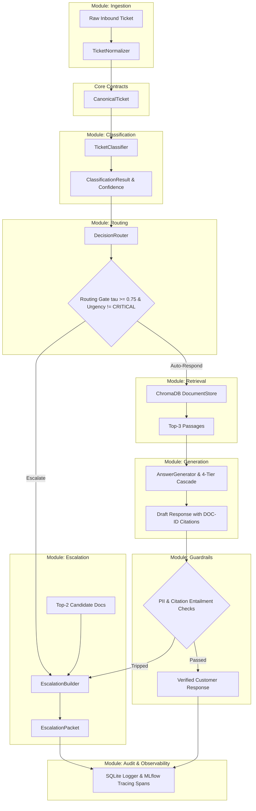

# CloudServe Support Orchestrator System Architecture

*   **Author:** Amlan Acharya
*   **Status:** Proposed
*   **Date:** 2026-10-30

--------------------------------------------------------------------------------

## Overview

The CloudServe Support Orchestrator is a decoupled, modular monolith processing pipeline engineered to ingest multi-channel customer inquiries, classify intent and urgency, route tickets using calibrated confidence thresholds, retrieve grounded knowledge base passages, synthesize citation-backed answers, and enforce active safety guardrails. The system delivers an automated first-contact resolution engine paired with an enriched, fail-safe human escalation packet builder, satisfying all 12 project acceptance criteria (A1–A12).

## The Problem

CloudServe's customer support operations face several scaling bottlenecks:
1. **Low First-Contact Resolution (FCR)**: Current FCR is 42%, falling far short of the 65% target.
2. **Repetitive Inquiries**: Approximately 70% of inbound tickets are repeat inquiries regarding password lockouts, rate limits, invoice inquiries, and rollback loops with known solutions.
3. **Documentation Retrieval Failure**: Support agents struggle to find answers across the 29 curated knowledge base articles because keyword search fails due to vocabulary mismatch (e.g., customer queries "deployment keeps dying" while the documentation article is titled "resolving container health check failures"). Non-fluent English inquiries exacerbate this gap.
4. **Escalation Inefficiency**: 50% of tickets escalated to Tier 2 could be resolved by Tier 1 if findability and intent confidence were resolved. Escalated tickets lack structured context, forcing senior engineers to repeat basic discovery.
5. **Operational and Trust Risk**: Incorrect automated responses directly damage customer trust. Critical production downtime inquiries cannot tolerate waiting, while informational inquiries require rigorous source attribution (`[DOC-ID]`).

The proposed solution is a modular monolith (`SupportOrchestrator`): strictly bounded, decoupled domain modules coordinated via a formal LangGraph `StateGraph`, paired with an MLflow GenAI tracing layer and a direct Python fallback execution path to ensure zero-crash resilience.

## Goals

*   **G1: Acceptance Criteria Fulfillment**: Satisfy all 12 project acceptance criteria (A1–A12).
*   **G2: Multi-Channel Canonical Ingestion**: Normalize raw inputs across four distinct channels (`email`, `chat`, `docs_comment`, `forum`) into a single `CanonicalTicket` schema without validation exceptions.
*   **G3: Calibrated Routing & Early Bifurcation**: Route tickets with confidence $\ge 0.75$ to automated response generation; route tickets with confidence $< 0.75$, critical urgency, or safety overrides (`must_not_auto_respond`) to human escalation.
*   **G4: Grounded Semantic Retrieval & Attribution**: Index 29 documentation articles using ChromaDB 0.3.21 and dense semantic embeddings (`all-MiniLM-L6-v2`), generating responses with verifiable `[DOC-ID]` citations.
*   **G5: Active Guardrails & Zero-Tolerance Escalation**: Block PII leaks and hallucinated claims; immediately divert tripped responses to human escalation without recursive retry loops.
*   **G6: Zero-Crash 4-Tier Fallback Cascade**: Ensure 100% completion across all evaluation batches via an inference fallback cascade (Groq $\rightarrow$ Gemini $\rightarrow$ HuggingFace $\rightarrow$ local offline heuristic engine).
*   **G7: Enriched Escalation Packaging**: Provide human agents with intent, urgency, confidence, routing reason, and top-2 candidate documentation links.
*   **G8: Modular Monolith Maintainability**: Enforce explicit domain boundaries, strict public interfaces, and zero circular dependencies across codebase modules.
*   **G9: Full-Stack Observability & Traceability**: Instrument every execution stage with OpenTelemetry/MLflow hierarchical spans and evaluation metrics.

## Non-Goals

*   **NG1: Live Telephony / Voice Processing**: Audio transcription and real-time voice handling are out of scope.
*   **NG2: Direct Ticketing System Write-Back**: Direct two-way sync or write-back mutations to external proprietary ticket tools (e.g., Zendesk, Jira Service Desk) are out of scope; output is delivered via API response and SQLite audit logs.
*   **NG3: Autonomous Account Mutation**: Automated execution of financial refunds, customer account modifications, or billing write-offs without human agent approval is strictly prohibited.
*   **NG4: Multi-Agent Recursive Debate**: Dynamic agent-to-agent iterative debates or unconstrained agent loops are excluded to preserve execution determinism and latency SLA bounds.
*   **NG5: Microservices Infrastructure Overhead**: Distributing components across separate microservice containers, network gRPC boundaries, or message queues is strictly excluded in favor of an in-process modular monolith.

## Open Questions

*   **Question 1**: Cross-Provider Calibration: In the 4-tier fallback cascade, do secondary and tertiary models (Gemini, HuggingFace) output confidence scores that track the $\tau = 0.75$ threshold calibrated on Groq, or is a per-provider scaling factor required?
*   **Question 2**: Vector DB Cache Warming: Should the 29 documentation articles be embedded and indexed strictly at application startup / evaluation initialization, or persisted to disk to eliminate cold-start overhead?

## Critical User Journeys (CUJs)

### CUJ 1: Automated First-Contact Resolution with Grounded Citations
*   **Given**: A customer submits an email or chat inquiry regarding a standard operational issue (e.g., container rollback loops) covered by documentation.
*   **When**: The ticket is ingested and classified with intent `troubleshooting`, urgency `MEDIUM`, and confidence $\ge 0.75$.
*   **Then**: The pipeline queries ChromaDB for top-3 articles, synthesizes a direct response citing `[DOC-ID]`, passes PII and hallucination guardrails, records the trace in SQLite and MLflow, and returns an automated resolution.

### CUJ 2: Fail-Safe Enriched Human Escalation for Critical / Low-Confidence Inquiries
*   **Given**: A customer submits an urgent inquiry reporting a production cluster outage or an ambiguous query with confidence $< 0.75$.
*   **When**: The routing gate detects `urgency == "CRITICAL"`, `confidence < 0.75`, or `must_not_auto_respond == true`.
*   **Then**: The pipeline immediately bypasses LLM answer generation and guardrails, retrieves top-2 candidate doc links from ChromaDB, constructs an `EscalationPacket` with routing justification, logs the event, and routes to human support.

### CUJ 3: Active Guardrail Tripping and Safe Diversion
*   **Given**: An automated draft response contains customer PII (e.g., an exposed API key or email) or an ungrounded claim not supported by retrieved context.
*   **When**: The guardrail evaluation module scans the generated text and flags a violation.
*   **Then**: The automated response is immediately suppressed, the ticket is converted into an escalated state with the guardrail violation diagnosis recorded in the packet, and no hallucinated text reaches the customer.

--------------------------------------------------------------------------------

## Technical Plan (Architecture)

### 1. Architectural Topology & Modular Monolith Pattern

The architecture is implemented as an in-process **Modular Monolith**:
* **In-Process Boundary Isolation**: All domain modules reside within a unified codebase, deployed and executed as a single process (zero inter-service network latency, zero distributed transaction overhead, and single `uv` virtual environment management).
* **Strict Encapsulation**: Each domain context (`ingestion`, `classification`, `routing`, `retrieval`, `generation`, `guardrails`, `audit`, `observability`) exposes its public API solely via its package root (`__init__.py`). Internal helper classes and utilities remain private to the module.
* **Core Shared Contracts (`src/core/`)**: Common data transfer objects (`CanonicalTicket`, `EscalationPacket`, `ProcessedTicketResult`) and configuration loaders reside in `src/core/`, preventing circular module dependencies.
* **Orchestrator as Module Coordinator (`src/orchestrator/`)**: The orchestration layer imports the public module interfaces and compiles them into a formal LangGraph `StateGraph`, paired with an internal pure Python DAG fallback runner for zero-crash A11 compliance.



### 2. Modular Monolith Directory Scaffolding

```text
├── pyproject.toml                     # uv project definition & editable package install
├── .env.example                       # API key & environment variable template
├── 06_Configuration/
│   └── requirements.txt               # Pinned dependencies (resolved for uv & Python 3.11)
├── src/
│   ├── __init__.py
│   ├── api.py                         # FastAPI REST application exposing /health & /tickets/process
│   ├── core/                          # Cross-cutting contracts and configuration
│   │   ├── __init__.py
│   │   ├── config.py                  # Settings & environment validation
│   │   └── models.py                  # CanonicalTicket, ProcessedTicketResult, EscalationPacket
│   ├── modules/
│   │   ├── ingestion/                 # Ingestion & channel normalization
│   │   │   ├── __init__.py            # Public API: normalize_ticket
│   │   │   └── normalizer.py
│   │   ├── classification/            # Intent & urgency classification with caching
│   │   │   ├── __init__.py            # Public API: classify_ticket
│   │   │   └── classifier.py
│   │   ├── routing/                   # Routing predicate & escalation packaging
│   │   │   ├── __init__.py            # Public API: evaluate_route, build_escalation_packet
│   │   │   ├── router.py
│   │   │   └── escalation.py
│   │   ├── retrieval/                 # ChromaDB 0.3.21 store & embedding wrapper
│   │   │   ├── __init__.py            # Public API: query_documents, index_corpus
│   │   │   └── store.py
│   │   ├── generation/                # Grounded answer synthesis & 4-tier model cascade
│   │   │   ├── __init__.py            # Public API: generate_response
│   │   │   ├── generator.py
│   │   │   └── cascade.py
│   │   ├── guardrails/                # PII detection & hallucination blocker
│   │   │   ├── __init__.py            # Public API: evaluate_guardrails
│   │   │   ├── pii.py
│   │   │   └── hallucination.py
│   │   ├── audit/                     # Append-only SQLite decision logger
│   │   │   ├── __init__.py            # Public API: log_decision, get_decision_history
│   │   │   └── logger.py
│   │   └── observability/             # MLflow GenAI Tracing & OpenTelemetry spans
│   │       ├── __init__.py            # Public API: init_tracing, trace_span
│   │       └── tracing.py
│   └── orchestrator/                  # Workflow assembly & execution engine
│       ├── __init__.py                # Public API: SupportOrchestrator
│       ├── state.py                   # AgentState TypedDict for LangGraph channels
│       ├── graph.py                   # StateGraph definition & node wiring
│       └── engine.py                  # Dual-runner: LangGraph primary + Python DAG fallback
├── evaluation/
│   ├── __init__.py
│   ├── harness.py                     # Batch CLI runner (--input, --output)
│   └── metrics.py                     # Accuracy, ECE, precision@k, PII, latency calculator
├── tests/
│   ├── unit/                          # Isolated module unit tests
│   │   ├── test_ingestion.py
│   │   ├── test_classification.py
│   │   ├── test_routing.py
│   │   ├── test_retrieval.py
│   │   ├── test_generation.py
│   │   └── test_guardrails.py
│   └── integration/                   # Pipeline end-to-end & resilience tests
│       ├── test_orchestrator.py
│       ├── test_audit_log.py
│       └── test_resilience.py
└── README.md                          # Quickstart, setup instructions & test commands
```

### 3. Execution Pipeline Stages & State Schema

#### State Schema (`src/orchestrator/state.py`)
```python
from typing import TypedDict, Any, Literal

class AgentState(TypedDict):
    ticket_id: str
    channel: str
    customer_id: str
    subject: str | None
    body_text: str
    thread_history: list[dict[str, str]]
    metadata: dict[str, Any]
    language_fluency: str
    inferred_intent: str | None
    urgency: Literal["LOW", "MEDIUM", "HIGH", "CRITICAL"] | None
    confidence: float | None
    routing_action: Literal["AUTO_RESPOND", "ESCALATE"] | None
    routing_reason: str | None
    retrieved_docs: list[dict[str, Any]]
    draft_response: str | None
    guardrail_status: Literal["PASSED", "TRIPPED"] | None
    guardrail_details: str | None
    escalation_packet: dict[str, Any] | None
    final_response: str | None
    citations: list[str]
    model_provider: str | None
    execution_latency_ms: float
    error_message: str | None
```

#### Ingestion & Schema Normalization (`src/modules/ingestion/`)
* Normalizes incoming raw payloads across four channels: `email`, `chat`, `docs_comment` (with aliasing), and `forum`.
* Produces a typed `CanonicalTicket` object.
* Sanitizes nullable or missing subject lines, maps non-fluent language into clean semantic representations, and preserves multi-turn thread history.

#### Intent & Urgency Classification (`src/modules/classification/`)
* Categorizes inquiry intent (`billing`, `authentication`, `deployment_failure`, `rate_limiting`, `general_inquiry`) and urgency (`LOW`, `MEDIUM`, `HIGH`, `CRITICAL`).
* Emits continuous calibrated confidence $c \in [0.0, 1.0]$.
* Enforces `temperature = 0.0`, fixed random seed, and exact-match deterministic caching keyed on `sha256(canonical_ticket_json)`.

#### Routing & Early Bifurcation (`src/modules/routing/`)
* Evaluates routing predicates:
  $$\text{Action} = \begin{cases} \text{AUTO\_RESPOND} & \text{if } c \ge 0.75 \land \text{urgency} \neq \text{CRITICAL} \land \neg \text{must\_not\_auto\_respond} \\ \text{ESCALATE} & \text{otherwise} \end{cases}$$
* Escalation branch executes top-2 ChromaDB candidate lookup and constructs `EscalationPacket`, bypassing LLM answer generation and guardrails entirely.

#### Grounded Retrieval & Answer Synthesis (`src/modules/retrieval/`, `src/modules/generation/`)
* **Vector Store**: Indexes 29 articles from `05_Datasets/documentation.json` in ChromaDB 0.3.21 with `sentence-transformers/all-MiniLM-L6-v2`.
* **4-Tier Inference Cascade**:
  1. Primary: Groq API (`llama-3.3-70b-versatile` / `openai/gpt-oss-120b`).
  2. Secondary: Google Gemini API (`gemini-2.5-flash`).
  3. Tertiary: HuggingFace Serverless Inference API.
  4. Quaternary / Offline: Local token-overlap heuristic mock over `documentation.json` ensuring 100% completion with zero crashes.
* Answer synthesis strictly enforces `[DOC-ID]` citation typography.

#### Active Safety Guardrails (`src/modules/guardrails/`)
* **PII Guardrail**: Pre/post-generation scanner scrubbing API keys, bearer tokens, customer passwords, credit card numbers, and phone numbers.
* **Hallucination Blocker**: Verifies token overlap, semantic entailment against retrieved context, and citation validity.
* **Zero-Tolerance Diversion**: Any guardrail trip immediately constructs an enriched escalation packet with safety diagnostics.

#### Audit Logging & Tracing (`src/modules/audit/`, `src/modules/observability/`)
* Records complete execution traces to append-only SQLite database (`decision_log.db`).
* Ships hierarchical spans to MLflow Tracing with token counts, latency, and node parameters.

--------------------------------------------------------------------------------

## Alternatives Considered

### Alternative A: Modular Monolith vs. Microservices vs. Unstructured Scripting
*   **Microservices Architecture**:
    *   *Pros*: Independent deployability of classification, retrieval, and generation services.
    *   *Cons*: Introduces inter-service network latency, complex docker-compose orchestration, high risk of container networking failures during grading, and violation of the project requirement to run cleanly from a single checkout.
*   **Unstructured Single-File Scripting**:
    *   *Pros*: Fast initial coding.
    *   *Cons*: Tangled state, untestable components, poor separation of concerns, and low implementation score on code maintainability (35% rubric weight).
*   **Chosen (Modular Monolith)**: In-process domain separation with explicit package boundaries (`src/modules/*`), single `uv` environment, zero network hops, and maximum unit testability.

### Alternative B: Complete Retrieval Bypass on Escalation Path
*   **Pros*: Minimizes latency on escalated tickets by skipping vector search entirely.
*   **Cons*: Deprives human agents of document context, directly contradicting discovery interview requirements from Daniel Okonkwo and Sofia Restrepo.
*   **Reason for Rejection**: Retaining a lightweight top-2 ChromaDB lookup provides essential context in `EscalationPacket` while skipping expensive LLM answer synthesis and guardrails.

### Alternative C: Recursive LLM Prompt Regeneration on Guardrail Trip
*   **Pros**: Opportunity to self-correct a flagged hallucination and increase deflection.
*   **Cons**: Introduces non-deterministic retry loops, causes tail latency spikes, burns tokens, and risks compounding hallucinations. Violates Marcus Adeyemi's reliability rule: *"I would rather it said nothing than said something wrong."*
*   **Reason for Rejection**: Zero-tolerance diversion immediately transfers tripped tickets to the human queue with clear diagnostic metadata.

### Alternative D: Single-Provider LLM Architecture
*   **Pros**: Simpler client codebase; single vendor account.
*   **Cons**: Vulnerable to provider outages, rate-limiting, and quota exhaustion; fails project acceptance criterion A11.
*   **Reason for Rejection**: A 4-tier cascade (Groq $\rightarrow$ Gemini $\rightarrow$ HF $\rightarrow$ Offline Local Mock) guarantees 100% test completion even under total network disconnection.

### Alternative E: Programmatic Prompt Compilation via DSPy
*   **Pros**: Metric-driven automated prompt tuning and teleprompter optimization (`BootstrapFewShot`, `MIPROv2`).
*   **Cons**: Dynamic prompt optimization violates the explicit Stage 3 coursework requirement ([Stage_3_Prompt_Library.docx](file:///c:/Users/amlan/Downloads/cloudserve/FDE_Capstone_Complete/Capstone_Pack/02_Stage_Workbooks/Stage_3_Prompt_Library.docx)) demanding a human-maintained prompt register with literal text, version history, and rationale. Compiling prompts at runtime burns LLM tokens and risks rate-limit crashes during unattended evaluation (A9). Furthermore, `dspy-ai` introduces major dependency conflicts with pinned packages.
*   **Reason for Rejection**: Rejected in favor of explicit, version-controlled static prompt templates with deterministic `sha256` caching and `temperature=0.0`.

--------------------------------------------------------------------------------

## Non-Functional Requirements

### 1. Security & Privacy
*   **PII & Credential Scrubbing**: Active pre-generation and post-generation scanning prevents API tokens, bearer keys, passwords, and sensitive customer identifiers from being echoed in responses or external logs.
*   **Credential Segregation**: All provider API keys (`GROQ_API_KEY`, `GEMINI_API_KEY`, `HF_TOKEN`) are loaded from environment variables (`.env`) and never checked into version control.

### 2. Performance & Latency SLA Bounds
*   **P95 Response Latency**: $\le 3.0$ seconds for automated responses; $\le 500$ ms for escalated tickets (via early bypass).
*   **Storage & Footprint**: ChromaDB vector index over 29 articles remains lightweight ($< 50$ MB disk footprint).
*   **Offline Determinism**: The Quaternary fallback mock operates with zero external network overhead, completing local keyword and semantic heuristic evaluation in $< 100$ ms per ticket.

### 3. Reliability & Rollout
*   **Zero-Crash Guarantee (A11)**: Every unhandled provider exception triggers downstream fallback in the cascade, concluding at the deterministic offline mock rather than an unhandled system abort.
*   **Dual-Interface Parity**: Both `src/api.py` and `evaluation/harness.py` consume `SupportOrchestrator` directly, ensuring evaluation metrics mirror production service behavior.

--------------------------------------------------------------------------------

## Detailed Implementation Plan

### Target Files to Create/Modify

#### 1. `06_Configuration/requirements.txt` & `pyproject.toml` (Modify / Create)
*   **Type / Scope**: Build & Dependency Management Configuration
*   **Proposed Changes**:
    *   Update `openai` pin from `openai==1.0.0` to `openai>=1.10.0,<2.0.0` to resolve the hard constraint conflict with `langchain-openai==0.0.7`.
    *   Add `mlflow>=2.10.0` for GenAI tracing and observability.
    *   Add `pyproject.toml` configuring the modular monolith as an installable package (`src`) under `uv` with Python 3.11.

#### 2. `src/core/models.py` & `src/core/config.py` (Create)
*   **Type / Scope**: Shared Core Contracts & Configuration
*   **Proposed Changes**:
    *   Define `CanonicalTicket`, `EscalationPacket`, and `ProcessedTicketResult` models.
    *   Implement centralized configuration loading (`Settings`) with `.env` validation.

#### 3. `src/modules/ingestion/` (Create)
*   **Type / Scope**: Ingestion & Channel Normalization Module
*   **Proposed Changes**:
    *   `src/modules/ingestion/normalizer.py`: Implement multi-channel parsing (`email`, `chat`, `docs_comment`, `forum`), field aliasing, and non-fluent language normalization.
    *   `src/modules/ingestion/__init__.py`: Export public API function `normalize_ticket(raw_payload: dict) -> CanonicalTicket`.

#### 4. `src/modules/classification/` (Create)
*   **Type / Scope**: Intent & Urgency Classification Module
*   **Proposed Changes**:
    *   `src/modules/classification/classifier.py`: Categorize intent and urgency with calibrated confidence score $c \in [0.0, 1.0]$. Implement `sha256(canonical_ticket_json)` exact-match cache for deterministic repeatability (A5).
    *   `src/modules/classification/__init__.py`: Export public API function `classify_ticket(ticket: CanonicalTicket) -> ClassificationResult`.

#### 5. `src/modules/routing/` (Create)
*   **Type / Scope**: Decision Routing & Escalation Packaging Module
*   **Proposed Changes**:
    *   `src/modules/routing/router.py`: Apply calibrated threshold $\tau = 0.75$, critical urgency override, and safety flag checks.
    *   `src/modules/routing/escalation.py`: Construct structured `EscalationPacket` with top-2 candidate documentation links and diagnostic failure logs.
    *   `src/modules/routing/__init__.py`: Export `evaluate_route(...)` and `build_escalation_packet(...)`.

#### 6. `src/modules/retrieval/` (Create)
*   **Type / Scope**: Knowledge Base Vector Store Module
*   **Proposed Changes**:
    *   `src/modules/retrieval/store.py`: ChromaDB 0.3.21 store (`all-MiniLM-L6-v2`) querying 29 articles from `05_Datasets/documentation.json`.
    *   `src/modules/retrieval/__init__.py`: Export `query_documents(text: str, top_k: int) -> list[DocumentChunk]` and `index_documentation()`.

#### 7. `src/modules/generation/` (Create)
*   **Type / Scope**: Grounded Synthesis & 4-Tier Cascade Module
*   **Proposed Changes**:
    *   `src/modules/generation/generator.py`: Citation-grounded answer generation enforcing `[DOC-ID]` typography.
    *   `src/modules/generation/cascade.py`: Resilient cascade client (Groq $\rightarrow$ Gemini $\rightarrow$ HF $\rightarrow$ Offline Local Heuristic Mock) guaranteeing 100% completion without crashes (A11).
    *   `src/modules/generation/__init__.py`: Export `generate_response(...)`.

#### 8. `src/modules/guardrails/` (Create)
*   **Type / Scope**: Active Safety Guardrails Module
*   **Proposed Changes**:
    *   `src/modules/guardrails/pii.py`: Regex and pattern-based PII/credential scanner.
    *   `src/modules/guardrails/hallucination.py`: Citation entailment and token-overlap validator.
    *   `src/modules/guardrails/__init__.py`: Export `evaluate_guardrails(...)`.

#### 9. `src/modules/audit/` & `src/modules/observability/` (Create)
*   **Type / Scope**: Persistence & Observability Modules
*   **Proposed Changes**:
    *   `src/modules/audit/logger.py`: Append-only SQLite decision logger (`decision_log.db`) with reconciliation queries (A8).
    *   `src/modules/observability/tracing.py`: MLflow GenAI Tracing setup and `@trace_span` decorators.

#### 10. `src/orchestrator/` (Create)
*   **Type / Scope**: Monolith Orchestrator & Workflow Assembly
*   **Proposed Changes**:
    *   `src/orchestrator/state.py`: `AgentState` TypedDict definition.
    *   `src/orchestrator/graph.py`: LangGraph `StateGraph` definition wiring domain module functions.
    *   `src/orchestrator/engine.py`: Primary runtime with dual-runner execution (LangGraph primary + pure Python DAG fallback).
    *   `src/orchestrator/__init__.py`: Export `SupportOrchestrator`.

#### 11. `src/api.py` (Create)
*   **Type / Scope**: FastAPI Web Service
*   **Proposed Changes**:
    *   Implement `/health` and `/tickets/process` endpoints consuming `SupportOrchestrator`.

#### 12. `evaluation/` (Create)
*   **Type / Scope**: Unattended Batch Evaluation CLI & Metrics (A9, A10)
*   **Proposed Changes**:
    *   `evaluation/harness.py`: CLI taking `--input` and `--output` flags to process evaluation datasets unattended.
    *   `evaluation/metrics.py`: Calculate accuracy, ECE, retrieval precision@k, citation accuracy, PII rate, latency P95, and estimated FCR.

#### 13. `tests/` Test Suite (Create)
*   **Type / Scope**: Unit and Integration Test Suite (A12)
*   **Proposed Changes**:
    *   `tests/unit/`: Test each module in isolation (`test_ingestion.py`, `test_classification.py`, `test_routing.py`, `test_retrieval.py`, `test_generation.py`, `test_guardrails.py`).
    *   `tests/integration/`: End-to-end integration and resilience testing (`test_orchestrator.py`, `test_audit_log.py`, `test_resilience.py`).

#### 14. `README.md` (Modify / Create)
*   **Type / Scope**: Project Documentation & Setup Guide
*   **Proposed Changes**:
    *   Document `uv` setup, single-command test execution (`pytest tests/ -v`), and evaluation harness commands (A1, A9, A12).

---

### Verification Plan

*   **Environment & Build Verification (A1)**:
    ```bash
    uv venv --python 3.11
    .venv\Scripts\activate
    uv pip install -r 06_Configuration/requirements.txt
    ```
*   **Unit & Integration Test Suite (A12)**:
    ```bash
    pytest tests/ -v
    ```
*   **Unattended Batch Evaluation Run (A9 & A10)**:
    ```bash
    python -m evaluation.harness --input 05_Datasets/validation_tickets.json --output evaluation/validation_report.json
    ```
*   **Fault-Tolerance & Resilience Verification (A11)**:
    Execute test suite with invalid API keys and disconnected network adapter to verify 100% completion via Quaternary offline fallback mock.

--------------------------------------------------------------------------------

*Drafted with EGM*
