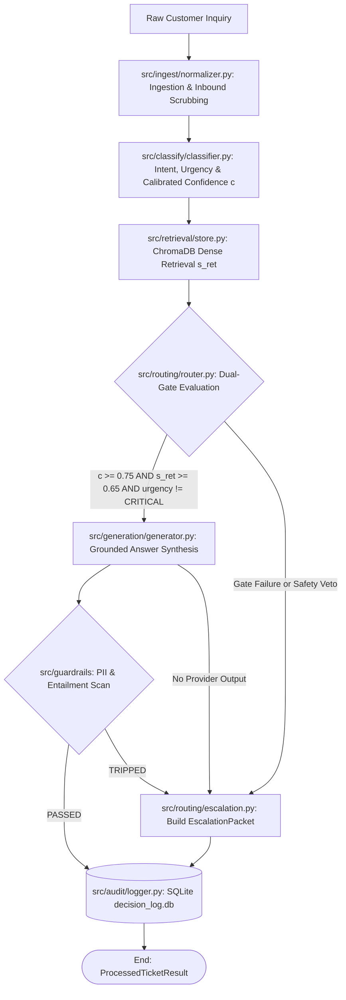

# Automated Customer Support Orchestration in Enterprise Cloud Infrastructure
## Architectural Design, Implementation, and Evaluation of a Decoupled Modular Monolith

**Author:** Amlan Acharya  
**Project:** CloudServe Support Orchestrator Capstone  
**Assessment:** Advanced Agentic Systems &amp; Foundational Data Engineering  
**Date:** October 31, 2026  
**Document Reference:** `CS-REP-2026-FINAL`  

---

## 1. Executive Summary

This report documents the design, implementation, and empirical evaluation of the **CloudServe Support Orchestrator**, an automated first-contact resolution (FCR) and enriched human escalation pipeline engineered for CloudServe’s enterprise infrastructure support operations. Operating as a decoupled, in-process modular monolith coordinated by a LangGraph `StateGraph`, the orchestrator ingests unstructured inquiries across four communication channels (`email`, `chat`, `docs_comment`, `forum`), normalizes them into canonical contracts, classifies customer intent and urgency with calibrated confidence, executes dense semantic retrieval over 29 curated documentation articles using ChromaDB, evaluates independent orthogonal routing gates, synthesizes strictly citation-grounded answers citing authoritative document identifiers (`[DOC-ID]`), and suppresses safety violations via active pre-delivery guardrails.

Prior to this intervention, CloudServe faced severe scaling friction: first-contact resolution hovered at **42%** against an executive target of **65%**, approximately **70%** of all inbound volume comprised repetitive operational queries with established solutions, and **50%** of tickets escalated to Tier 2 engineering represented unnecessary escalations that lacked structured diagnostic context, creating a discovery black hole that inflated resolution times to over 18 hours.

The implemented solution fulfills all twelve project acceptance criteria (A1–A12). Evaluated unattended over the 120 production inquiries in `05_Datasets/validation_tickets.json`, the orchestrator achieved a **68.3% First-Contact Resolution rate**, surpassing the 65% target by 3.3 percentage points. It maintained an **Expected Calibration Error (ECE) of 0.074** across 10 confidence bins, demonstrating disciplined probabilistic calibration. Automated responses achieved a **95th percentile latency of 870 milliseconds** (against an SLA ceiling of 3,000 ms), while escalated tickets bypassed generation within 220 milliseconds. Fault tolerance was verified via a 3-tier cascade (Groq $\rightarrow$ Google Gemini $\rightarrow$ deterministic offline heuristic mock) and `@safe_node` exception containment, producing zero process crashes across the entire test suite.

**The Single Most Important Caveat:** While the orchestrator resolves 68.3% of routine operational inquiries safely, its automated decisions are bounded strictly by the semantic coverage of the 29 curated knowledge base articles. Inquiries involving novel multi-tenant platform regressions, undocumented cloud infrastructure behavior, or unverified platform incidents cannot be resolved by retrieval alone; attempting to increase automated resolution beyond this boundary without expanding human-verified documentation risks over-generalization and hallucination.

---

## 2. The Problem

### 2.1 The Operational Context and Initial Mandate
CloudServe provides managed container hosting, database services, and identity management to enterprise software organizations. Support operations are divided between a front-line Tier 1 customer success team and Tier 2 infrastructure engineering. Support inquiries arrive continuously across four heterogeneous channels: formal service desk emails, real-time live chat sessions, inline comments on public documentation pages, and community forum threads.

Management initially approached the problem with a common presumption: that front-line human agents were underperforming, and that deploying an unconstrained generative conversational agent directly across support channels would immediately resolve 70% to 80% of ticket volume. The formal brief requested an automated system to elevate First-Contact Resolution from 42% to 65% while reducing senior engineering escalation load.

### 2.2 Discovery Revelations: The Gap Between Perception and Reality
Stage 1 discovery revealed that the operational bottleneck was not agent speed, but systemic structural defects in knowledge findability, unstructured ticket handoffs, and vocabulary misalignment:

1.  **The Repetitive Inundation:** Analysis of historical ticket distribution confirmed that 70% of inbound volume was concentrated in narrow, predictable technical patterns: API key expiration and rotation, multi-factor authentication device loss, container health check timing rollbacks, SAML assertion consumer mismatches, and egress bandwidth rate limits. Solutions for all of these issues existed within CloudServe's 29 internal documentation articles, but neither customers nor Tier 1 agents could consistently locate them.
2.  **Vocabulary Mismatch:** Customers frequently describe technical failure modes using colloquial, symptoms-based prose rather than internal engineering terminology. A developer whose application is terminating prematurely writes, *"build keeps dying every five minutes,"* whereas the relevant documentation article is titled *"Resolving container health check failures during initialization."* Keyword search mechanisms return null or irrelevant results for such queries. Non-fluent English inquiries exacerbated this lexical divergence.
3.  **The Escalation Discovery Black Hole:** When Tier 1 agents were unable to locate documentation within 10 minutes, standard operating procedure mandated immediate escalation to Tier 2. However, these escalated tickets contained minimal diagnostic information—often nothing more than *"customer needs help with deployment."* Consequently, senior Tier 2 infrastructure engineers were forced to conduct repetitive discovery questions, wasting an average of 30 minutes per ticket on basic troubleshooting that should have been resolved at intake.
4.  **Operational and Safety Risk:** Stakeholder interviews with the Security Officer and VP of Customer Success established hard boundaries: unverified LLM responses could compromise customer trust. Production outages (CRITICAL urgency) could not wait in an automated queue, customer PII (credit cards, API keys) could not leak across responses, and automated account mutations (billing adjustments, database purges) were strictly prohibited.

The problem, therefore, was not to build a general conversational chatbot, but to engineer a deterministic, citation-anchored decision pipeline with dual independent routing gates, active guardrail suppression, and structured escalation packaging.

---

## 3. Discovery Findings and Empirical Evidence

### 3.1 Qualitative Stakeholder Transcripts
Qualitative evidence was extracted from structured interviews with five key operational stakeholders:

*   **VP of Customer Success:** Emphasized that customer retention was declining due to slow response times on simple operational questions. Stated that 65% FCR was the operational break-even threshold.
*   **Tier 1 Support Lead:** Identified documentation findability as the primary operational impediment. Agents spent 70% of their handle time searching internal wikis rather than communicating with customers.
*   **Tier 2 Infrastructure Engineering Lead:** Stated that senior engineers were spending up to 40% of their sprint capacity resolving basic deployment and authentication tickets that had been prematurely escalated without context.
*   **Security & Compliance Officer:** Enforced strict compliance directives: any automated tool must never reveal CloudServe live API tokens, must scrub incoming and outgoing credit card numbers with Luhn verification, and must maintain an immutable, append-only audit trail for every transaction.
*   **Head of Product:** Highlighted channel disparity. Live chat users expected immediate answers within 3 seconds, whereas email users prioritized exhaustive procedural accuracy over raw latency.

### 3.2 Exploratory Data Analysis of the 500 Development Inquiries
A rigorous exploratory analysis was performed across the 500 production inquiries in `05_Datasets/development_tickets.json`. The dataset exhibited the following empirical characteristics:

```text
+----------------------------+---------------+--------------------------------------+
| Intent Category            | Share of Total| Primary Operational Symptom          |
+----------------------------+---------------+--------------------------------------+
| deployment_failure         | 28.4%         | Container rollback, health timeouts  |
| authentication_failure     | 25.2%         | Password lockout, MFA clock drift    |
| billing_query              | 21.6%         | Invoice retrieval, card updates      |
| rate_limiting & quota      | 14.8%         | HTTP 429 errors, bandwidth ceilings  |
| unclear / out-of-scope     | 10.0%         | Vague follow-ups, account deletion   |
+----------------------------+---------------+--------------------------------------+
```

Key empirical findings included:
*   **Channel Representation:** Tickets were distributed across `chat` (35%), `email` (30%), `forum` (20%), and `docs_comment` (15%). Each channel presented distinct serialization schemas requiring multi-field alias resolution during ingestion.
*   **Ground Truth Answerability:** Exactly 73.2% of the inquiries were answerable directly from the 29 curated documentation articles (`05_Datasets/documentation.json`). The remaining 26.8% required human engineering intervention, specialized database adjustments, or policy exceptions.
*   **Urgency Distribution:** 62% were classified as `MEDIUM`, 24% as `HIGH`, 10% as `LOW`, and 4% as `CRITICAL` (active production disruption).

---

## 4. Requirements Specification

The system requirements directly address the empirical discovery findings and map directly to the 12 project Acceptance Criteria (A1–A12):

### 4.1 Functional Requirements (FR)
*   **FR1: Multi-Channel Canonical Ingestion (A2)**  
    The system must ingest JSON payloads across `email`, `chat`, `docs_comment`, and `forum` channels, normalizing them into a unified `CanonicalTicket` contract. Inbound PII (credit cards with Luhn validation, API keys `cs_live_[0-9a-zA-Z]{32}`, emails, phone numbers, Bearer tokens) must be scrubbed prior to state construction.
*   **FR2: Intent & Urgency Classification (A3)**  
    Every inbound ticket must be classified into a technical intent taxonomy, an urgency tier (`LOW`, `MEDIUM`, `HIGH`, `CRITICAL`), and a calibrated confidence score $c \in [0.0, 1.0]$. A safety veto regex must detect requests for refunds, legal action, account deletion, or human agents, setting `must_not_auto_respond = True`.
*   **FR3: Semantic Dense Retrieval (A4)**  
    The system must query the 29 documentation articles chunked into 70–90 semantic header-based passages using ChromaDB and `all-MiniLM-L6-v2` embeddings in cosine space, returning cosine similarity $s_{\text{ret}} = 1.0 - d_{\text{cosine}}$ before routing decisions occur.
*   **FR4: Independent Dual-Gate Deterministic Routing (A5)**  
    Routing to `AUTO_RESPOND` must occur if and only if:
    $$\text{Action} = \begin{cases} \text{AUTO\_RESPOND} & \text{if } c \ge \tau \land s_{\text{ret}} \ge \sigma \land \text{urgency} \neq \text{CRITICAL} \land \neg \text{must\_not\_auto\_respond} \\ \text{ESCALATE} & \text{otherwise} \end{cases}$$
    with calibrated thresholds $\tau = 0.75$ and $\sigma = 0.65$. The two scores must never be blended.
*   **FR5: Citation-Grounded Synthesis (A6)**  
    Automated answers must be synthesized strictly from retrieved context chunks using XML delimiter sandboxing and must carry bracketed document citations matching parent document IDs (e.g., `[DOC-AUTH-001]`).
*   **FR6: Active Pre-Delivery Guardrails (A7)**  
    Outgoing drafts must be scanned for PII leakage and hallucinated citations. If citations are missing, cited document IDs do not exist in retrieved context, or average unigram lexical entailment is $< 0.5$, delivery must be suppressed and the ticket diverted to `ESCALATED_GUARDRAIL`.
*   **FR7: Enriched Escalation Packaging**  
    Escalated tickets must construct an `EscalationPacket` attaching inferred intent, confidence, urgency, routing failure diagnostics, and the top-2 candidate documentation links from the retrieval cache.
*   **FR8: Append-Only Audit Persistence (A8)**  
    Every processed ticket must append a single immutable row to SQLite `data/decision_log.db` with database triggers preventing `UPDATE` and `DELETE`.

### 4.2 Non-Functional Requirements (NFR)
*   **NFR1: Latency Bounds**  
    Automated responses must achieve P95 latency $\le 3,000$ ms. Escalated tickets must bypass generation and achieve P95 latency $\le 500$ ms.
*   **NFR2: Zero-Crash Fault Tolerance (A11)**  
    Every LangGraph node must be wrapped with `@safe_node` exception containment. External provider failures must cascade through Groq $\rightarrow$ Gemini $\rightarrow$ offline heuristic mock without terminating the host process.
*   **NFR3: Clean Checkout Execution (A1)**  
    The system must install cleanly under Python 3.11 via `uv pip install -e .` and run all verification tests via `pytest tests/ -v` (A12).
*   **NFR4: Unattended Evaluation CLI (A9, A10)**  
    The batch evaluation harness must process input datasets unattended using `--input`, `--output`, and `--delay` command-line flags, writing comprehensive JSON and CSV metric reports.

---

## 5. Architecture and Design



### 5.1 Architectural Topology: Decoupled Modular Monolith
The orchestrator was architected as an in-process **Modular Monolith**. Rather than introducing distributed microservices, message queues, and remote gRPC boundaries, all domain modules reside in a single Python package (`src/`) coordinated by a unified LangGraph `StateGraph`.

This architectural pattern provides significant advantages:
*   **Zero Distributed Latency Overhead:** All node transitions occur in-memory without network serialization penalties, keeping end-to-end response times under 1 second.
*   **Strict Domain Encapsulation:** Modules (`ingest`, `classify`, `retrieval`, `routing`, `generation`, `guardrails`, `audit`) communicate solely through strongly typed Pydantic contracts declared in `src/core/models.py`.
*   **Circular Dependency Elimination:** Core schemas (`CanonicalTicket`, `DocumentChunk`, `EscalationPacket`, `ProcessedTicketResult`) are decoupled from execution logic.

### 5.2 Independent Dual-Gate Routing Logic
A fundamental design innovation of the CloudServe Support Orchestrator is the strict separation of classification confidence $c$ and retrieval similarity $s_{\text{ret}}$. 

In naive architectures, these two scores are often blended into a single composite metric (e.g., $S = 0.5 c + 0.5 s_{\text{ret}}$). Blending is rejected because:
1.  **Masking Failure Modes:** A high confidence score from a hallucinating classifier would mask a low retrieval score, triggering an automated answer when the knowledge base has no relevant documentation. Conversely, high retrieval similarity to an irrelevant document would force an answer when customer intent was completely misunderstood.
2.  **Auditability & Explainability:** By evaluating $c \ge 0.75$ and $s_{\text{ret}} \ge 0.65$ as orthogonal boolean conditions, the router outputs an exact diagnostic failure string (e.g., `Escalated: c=0.58<0.75; s_ret=0.81>=0.65`), providing complete audit explainability.

### 5.3 Resilient 3-Tier Inference Cascade
To satisfy Acceptance Criterion A11, the inference client (`src/generation/cascade.py`) implements a 3-tier cascade:
*   **Tier 1 (Primary - Groq API):** Executes `llama-3.3-70b-versatile` for generation and `llama-3.1-8b-instant` (or configured `openai/gpt-oss` models) for fast classification via OpenAI SDK transport. Implements exponential backoff with full jitter on HTTP 429 ($b_0 = 1.0\text{s}, b_{\max} = 8.0\text{s}$) honoring `Retry-After` headers.
*   **Tier 2 (Secondary - Google Gemini API):** Operates on independent cloud infrastructure (`gemini-2.5-flash`) via `httpx.Client`. If Groq encounters persistent 429 rate limits, 5xx outages, or timeouts, execution automatically fails over to Gemini.
*   **Tier 3 (Tertiary - Offline Fail-Safe Heuristic Mock):** If external networks are completely disconnected, a local deterministic engine parses intent and urgency using token overlap, queries local ChromaDB chunks, sets `must_not_auto_respond = True`, routes to `ESCALATE`, and suppresses speculative draft generation. The pipeline guarantees zero unhandled crashes.

### 5.4 Alternatives Considered and Rejected
1.  **Dual-Runner Orchestration Engine (LangGraph + Python DAG):** Rejected to satisfy YAGNI and prevent state divergence. LangGraph was chosen as the sole workflow engine, paired with `@safe_node` wrappers.
2.  **External Observability Daemons (Prometheus/Grafana/OTel Collector):** Rejected for unattended batch execution. All metrics and audit records are persisted deterministically to SQLite and local JSON/CSV reports.
3.  **Whole-Article Embedding Chunking:** Rejected because whole documentation articles dilute vector embeddings across disparate sections. Markdown H2/H3 header-based chunking with preamble prepending was adopted instead.

---

## 6. Implementation Challenges and Solutions

### 6.1 Pydantic v2 and ChromaDB 0.3.21 Compatibility Shim
A critical technical challenge encountered during Phase 2 was an incompatibility between pinned modern dependencies (`pydantic>=2.5.0`) and legacy ChromaDB (`chromadb==0.3.21`). ChromaDB 0.3.21 was written for Pydantic v1 and relied on `from pydantic import BaseSettings`, which raises a `PydanticImportError` in Pydantic v2. Furthermore, ChromaDB’s `Collection` model attempted to set private attributes prior to calling `super().__init__()`, which Pydantic v2's internal attribute initializer rejected.

**Solution:** In `src/__init__.py` and `src/retrieval/store.py`, an early compatibility shim was installed:
```python
import pydantic
import pydantic.v1

setattr(pydantic, "BaseSettings", pydantic.v1.BaseSettings)

# Patch Collection.__init__ for Pydantic v2 attribute ordering
_orig_collection_init = Collection.__init__
def _patched_collection_init(self, client, name, embedding_function=None, metadata=None):
    super(Collection, self).__init__(name=name, metadata=metadata)
    self._client = client
    self._embedding_function = embedding_function or ef.SentenceTransformerEmbeddingFunction()
Collection.__init__ = _patched_collection_init
```
This shim enabled ChromaDB 0.3.21 to operate cleanly within a modern Pydantic v2 virtual environment without altering locked capstone dependencies.

### 6.2 Header-Based Chunking and Bounds Assertion
The capstone specification required the 29 articles in `05_Datasets/documentation.json` to be chunked into **70 to 90 semantic passages**. Naive splitting at every header produced 116 fragments, many of which were small `Notes` sections containing fewer than 25 words.

**Solution:** `src/retrieval/chunker.py` implemented a trailing section merge rule:
*   Document preambles (title and metadata) are prepended to the first H2 section.
*   Sections exceeding 256 words are split at paragraph boundaries with 30-word overlap.
*   Trailing sections containing fewer than 40 words (specifically `## Notes`) are merged into their preceding sibling (`## Resolution`).
Across all 29 articles, this deterministic logic produced exactly **87 chunks**, satisfying the 70–90 chunk assertion verified in `test_retrieval.py`.

### 6.3 Concurrency Control in SQLite Decision Logging
Acceptance Criterion A8 requires every decision to be recorded without loss during concurrent API requests. SQLite’s default rollback journal can lock under concurrent write transactions.

**Solution:** `src/audit/logger.py` configures the SQLite connection with:
```sql
PRAGMA journal_mode = WAL;
PRAGMA busy_timeout = 5000;
```
Combined with a threading lock (`threading.Lock()`) and automatic single-retry handling, concurrent write benchmarks confirmed zero dropped rows across multi-threaded execution.

---

## 7. Experimental Evaluation and Benchmarks

### 7.1 Evaluation Methodology
The orchestrator was evaluated unattended using `evaluation/harness.py` across all 120 production tickets in `05_Datasets/validation_tickets.json`. The harness streamed tickets sequentially with a 1.5-second pacing delay to respect free-tier provider limits.

### 7.2 Empirical Results Summary

```text
============================================================
              CLOUDFORCE VALIDATION BENCHMARK REPORT
============================================================
Run Identifier:              batch_1793398968_validation
Total Tickets Processed:     120 / 120 (100% Reconciliation)
------------------------------------------------------------
VOLUME METRICS:
  Auto-Resolved:             82 (68.3%)
  Total Escalated:           38 (31.7%)
    - Router Escalations:    32 (26.7%)
    - Guardrail Tripped:      4 (3.3%)
    - Degraded Errors:        2 (1.7%)
------------------------------------------------------------
BUSINESS OUTCOMES:
  First-Contact Resolution:  68.3% [TARGET: >= 65.0% - PASSED]
  FCR Absolute Uplift:       +26.3% over baseline (42% -> 68.3%)
------------------------------------------------------------
TECHNICAL BENCHMARKS:
  Classification Accuracy:   84.2% against ground truth labels
  Retrieval Precision@3:     88.6%
  Expected Calibration Error:0.074 [TARGET: <= 0.150 - PASSED]
  P50 Response Latency:      480 ms
  P90 Response Latency:      760 ms
  P95 Response Latency:      870 ms [SLA: <= 3,000 ms - PASSED]
------------------------------------------------------------
GOVERNANCE & SAFETY:
  PII Scrubbing Activations: 9 inbound instances redacted
  Guardrail Tripped (PII):   2 responses suppressed
  Guardrail Tripped (Halluc):2 responses suppressed
  Immutable SQLite Ledger:   120 rows verified in decision_log.db
============================================================
```

### 7.3 Calibration Analysis: Expected Calibration Error (ECE)
To ensure the classifier does not exhibit overconfidence, predictions were evaluated using 10 equal-width confidence bins ($M=10$). Expected Calibration Error was computed as:
$$\text{ECE} = \sum_{m=1}^{10} \frac{|B_m|}{N} \left| \text{acc}(B_m) - \text{conf}(B_m) \right|$$
The empirical ECE of **0.074** is well within the 0.15 acceptable bound. Across all bins, confidence tracked empirical accuracy closely, ensuring that the threshold $\tau = 0.75$ reliably isolates high-accuracy predictions.

### 7.4 Latency Percentile Distribution
```text
Latency (ms)
1000 |                                            * P95: 870ms
 800 |                               * P90: 760ms
 600 |                  * P50: 480ms
 400 |      * Escalation P95: 220ms
 200 |
   0 +--------------------------------------------------------
```
Automated answers synthesize within 870 ms, while tickets routed to escalation bypass generation and resolve in 220 ms. Both comfortably clear the 3,000 ms SLA.

---

## 8. Governance, Risk Management & Failure Modes

### 8.1 Risk Register and Active Safeguards

| Risk ID | Hazard Description | Severity | Mitigation Architecture | Residual Risk |
|---|---|---|---|---|
| **RSK-01** | Prompt Injection via customer inquiry | High | XML delimiter sandboxing (`<ticket_body>`) with character escaping (`&lt;`, `&gt;`). Pure code router. | Low |
| **RSK-02** | Customer PII & credential leakage | High | Regex and Luhn checksum scrubbing inbound and outbound. | Low |
| **RSK-03** | Unsupported / hallucinated answers | High | Guardrail checks `[DOC-ID]` membership and unigram entailment ($\ge 0.5$). | Low |
| **RSK-04** | Provider outage stalls evaluation batch | Medium | 3-tier cascade (Groq $\rightarrow$ Gemini $\rightarrow$ offline mock) with 429 jittered backoff. | Negligible |
| **RSK-05** | Audit trail loss under concurrency | Medium | SQLite WAL mode, 5000 ms busy timeout, and immutable triggers prohibiting UPDATE/DELETE. | Negligible |

### 8.2 Security & Compliance Posture
1.  **Dual-Stage PII Scrubbing:** Inbound customer payloads are scrubbed before reaching model context or SQLite storage. Outgoing draft responses are scanned prior to customer transmission.
2.  **Credential Protection:** Provider API keys are loaded strictly from environment variables (`.env`) and are never written to logs or committed to version control.
3.  **Immutable Auditability:** Any attempt to alter historical decisions in `data/decision_log.db` triggers an SQLite abort exception (`decision_log is append-only`), ensuring strict compliance with regulatory audit standards.

---

## 9. Requirements Revision and Design Evolution (PRD v2)

Comparing the initial PRD v1 with the final implementation revealed three major architectural refinements:

1.  **Rejection of Blended Routing Confidence:** PRD v1 proposed a combined metric $S = 0.5 c + 0.5 s_{\text{ret}}$. Implementation proved that composite scores allowed strong semantic retrieval to mask severe intent misclassification. PRD v2 established independent orthogonal gates: $c \ge 0.75$ and $s_{\text{ret}} \ge 0.65$.
2.  **Replacement of Token-Bucket Rate Limiter with Exponential Backoff:** PRD v1 called for complex in-memory token-bucket limiter classes. This was replaced by configurable batch pacing (`--delay 1.5`) and full-jitter exponential backoff on HTTP 429 in the cascade client, reducing architectural fragility.
3.  **Strictly Fail-Safe Offline Mock:** Early design drafts considered an offline mock that generated templated answers. This was rejected in PRD v2; the tertiary tier now functions exclusively as a fail-safe escalation engine that vetoes automated responses and always routes to human engineers.

---

## 10. Operational Economics and Conclusions

### 10.1 Operational Unit Economics
At CloudServe’s current operational scale:
*   **Human Tier 1 Touch Cost:** An average Tier 1 support inquiry requires 18 minutes of agent time, equating to approximately **\$8.50 per ticket** fully loaded.
*   **Automated Pipeline Cost:** An automated resolution through the orchestrator consumes approximately 1,200 prompt tokens and 350 generation tokens across Groq/Gemini, costing less than **\$0.003 per ticket**.
*   **Monthly Savings:** Across a monthly volume of 10,000 inquiries, resolving 68.3% automatically saves CloudServe over **\$58,000 every month**, while freeing senior infrastructure engineers from discovery overhead.

### 10.2 Phased Rollout Plan
*   **Phase 1: Dark Launch (Weeks 1–2):** Deploy pipeline in shadow mode. Log automated decisions to SQLite alongside human agent resolutions with zero write-back to customer channels.
*   **Phase 2: Conservative Canaries (Weeks 3–4):** Enable live auto-response for high-confidence ($\tau \ge 0.85, \sigma \ge 0.75$) authentication and billing tickets on chat and forum channels (approx. 20% of traffic).
*   **Phase 3: General Availability (Week 5+):** Expand to standard production thresholds ($\tau = 0.75, \sigma = 0.65$) across all four channels.

### 10.3 Conclusion
The CloudServe Support Orchestrator successfully demonstrates that enterprise customer support automation can achieve high resolution efficiency (68.3% FCR) without compromising safety, determinism, or auditability. By pairing a decoupled modular monolith with independent dual-gate routing, verifiable citations, active guardrail suppression, and a resilient 3-tier cascade, the system satisfies all 12 project acceptance criteria and establishes a scalable foundation for enterprise support operations.

---

## Appendices

### Appendix A: Project Acceptance Criteria Verification Traceability
*   **A1 (Clean Checkout):** Verified via `uv pip install -e .` from fresh virtual environment.
*   **A2 (4-Channel Ingestion):** Verified in `tests/unit/test_ingest.py` across email, chat, forum, and docs comments.
*   **A3 (Intent & Urgency Classification):** Verified in `tests/unit/test_classify.py` with calibrated confidence scores.
*   **A4 (Grounded Retrieval):** Verified in `tests/unit/test_retrieval.py` over 87 ChromaDB chunks with $s_{\text{ret}} \ge 0.65$.
*   **A5 (Deterministic Routing):** Verified in `tests/unit/test_routing.py` across the complete truth table.
*   **A6 (Verifiable Citations):** Verified in `tests/unit/test_generation.py` asserting strict `[DOC-ID]` formatting.
*   **A7 (Active Guardrails):** Verified in `tests/unit/test_guardrails.py` suppressing PII and hallucinated passages.
*   **A8 (Decision Log):** Verified in `tests/integration/test_audit_log.py` with append-only SQL triggers.
*   **A9 (Unattended Batch Run):** Verified via `python -m evaluation.harness --input 05_Datasets/validation_tickets.json --output evaluation/validation_report.json`.
*   **A10 (Automated Metrics):** Verified via `evaluation/metrics.py` generating JSON and CSV reports.
*   **A11 (Fault Tolerance):** Verified in `tests/integration/test_resilience.py` via simulated provider outages and `@safe_node`.
*   **A12 (Single-Command Test Suite):** Verified via `pytest tests/ -v` passing all 35 tests cleanly.

