# Stage 4: Sprint Plan & Implementation Roadmap

**Author:** Amlan Acharya  
**Project:** CloudServe Support Orchestrator  
**Framework:** Agile Scrum / 3-Week Iterative Sprint Cycle  
**Status:** Executed & Completed  

---

## 1. Sprint Overview & Objectives

The CloudServe Support Orchestrator project was executed over a three-week development sprint divided into three targeted milestones:
1. **Week 1 (Discovery & Architecture Alignment):** Ingest stakeholder evidence, conduct exploratory data analysis (EDA) across 500 tickets, establish PRD requirements (FR-01 to FR-10, NFR-01 to NFR-04), and build the prompt engineering library.
2. **Week 2 (Core Engineering & Modular Monolith):** Develop data normalization, chunking, ChromaDB vector indexing, dual-gate routing, LLM generation cascade, active guardrails, SQLite audit logging, and LangGraph workflow orchestration.
3. **Week 3 (Evaluation, Hardening & Deliverables Packaging):** Execute unattended batch evaluation CLI across 120 tickets, verify 10-bin Expected Calibration Error (ECE) and FCR uplift, produce the Capstone Technical Report, HyperFrames interactive presentation deck, and 20-minute video presentation runbook.

---

## 2. Capacity Planning & Team Allocation

| Sprint Phase | Planned Hours | Actual Hours | Core Focus & Milestones | Outcome |
|---|---|---|---|---|
| **Week 1** *(Days 1–3)* | 32.0 | 31.0 | Stakeholder interview synthesis, 500-ticket EDA, PRD v1 authoring, Prompt Library architecture. | Completed Discovery Workbook, PRD v1, and Prompt Library ahead of schedule. |
| **Week 2** *(Days 4–7)* | 38.0 | 43.0 | Modular Monolith implementation, ChromaDB Pydantic v2 shimming, LangGraph state graph, 35 unit/integration tests. | Completed all 35 tests with 100% pass rate; resolved DuckDB lock & Pydantic conflicts. |
| **Week 3** *(Days 8–9)* | 25.0 | 22.0 | Batch evaluation run, ECE & latency metrics compilation, Capstone Report authoring, HyperFrames slide deck, video runbook. | Full Capstone delivery package finalized; all 12 Acceptance Criteria validated. |
| **Total** | **95.0** | **96.0** | **End-to-End Orchestrator Delivery** | **Delivered On Time & Within Scope (+1.0 hr variance)** |

---

## 3. Work Breakdown Structure (WBS)

```mermaid
graph TD
    A["CloudServe Support Orchestrator"] --> B["Phase 1: Ingestion & Retrieval"]
    A --> C["Phase 2: Classification & Routing"]
    A --> D["Phase 3: Generation & Guardrails"]
    A --> E["Phase 4: Persistence & Graph"]
    A --> F["Phase 5: Evaluation & API"]
    A --> G["Phase 6: Reporting & Presentation"]

    B --> B1["Multi-channel Normalizer (FR-01)"]
    B --> B2["PII / Luhn Scrubber (FR-02)"]
    B --> B3["H2/H3 Chunker (87 chunks) (FR-04)"]
    B --> B4["ChromaDB Vector Store (FR-04)"]

    C --> C1["Intent & Urgency Classifier (FR-03)"]
    C --> C2["SHA-256 In-Memory Cache (FR-03)"]
    C --> C3["Dual-Gate Router (FR-05)"]
    C --> C4["Escalation Packet Builder (FR-08)"]

    D --> D1["Cascade Engine (Groq -> Gemini -> Mock) (FR-06)"]
    D --> D2["XML Sandboxed Generation (FR-06)"]
    D --> D3["PII Guardrail Scanner (FR-07)"]
    D --> D4["Hallucination & Entailment Engine (FR-07)"]

    E --> E1["SQLite Append-Only Audit Logger (FR-09)"]
    E --> E2["LangGraph StateGraph Workflow (A11)"]
    E --> E3["@safe_node Exception Boundary (A11)"]

    F --> F1["Batch Evaluation CLI (FR-10)"]
    F --> F2["Metrics Engine (ECE, FCR, P95) (A10)"]
    F --> F3["FastAPI REST Endpoints (A1)"]

    G --> G1["Comprehensive Capstone Report (10 Sections)"]
    G --> G2["HyperFrames Interactive Presentation Deck"]
    G --> G3["20-Minute Video Runbook & Demonstration"]
    G --> G4["Stage 1-5 Workbooks & Effort Log"]
```

---

## 4. Sprint Backlog & User Stories

| Story ID | User Story | Functional Req | Story Points | Acceptance Criteria | Status |
|---|---|---|---|---|---|
| **US-01** | *As an operations engineer*, I need multi-channel tickets parsed into a single standard schema so downstream components remain clean. | FR-01, FR-02 | 3 | Normalizes email, chat, forum, doc comments; redacts PII and Luhn credit cards. | **Done** |
| **US-02** | *As a Tier 1 agent*, I need documentation semantically chunked and indexed so colloquial searches return precise passages. | FR-04 | 5 | Exactly 87 chunks across 29 articles; top-$k$ retrieved via ChromaDB in $< 100$ ms. | **Done** |
| **US-03** | *As the Head of Support*, I need intent and urgency accurately classified with calibrated confidence so routing is deterministic. | FR-03 | 5 | 10-bin ECE $\le 0.15$; outage safety veto forces `CRITICAL` urgency. | **Done** |
| **US-04** | *As an infrastructure lead*, I need routing to use independent gates so ambiguous queries with high semantic similarity are never auto-responded. | FR-05 | 5 | $c \ge 0.75$, $s_{\text{ret}} \ge 0.65$, urgency $\neq$ CRITICAL; pure boolean gates. | **Done** |
| **US-05** | *As an end customer*, I need answers strictly grounded in official docs with clear citations so I never receive hallucinated instructions. | FR-06 | 8 | Cites `[DOC-ID]`; XML boundary defense; 3-tier cascade fallback on API failure. | **Done** |
| **US-06** | *As a compliance officer*, I need all outgoing drafts scanned for PII and ungrounded claims before delivery. | FR-07 | 5 | Diverts tripped drafts to `ESCALATED_GUARDRAIL`; logs violation metadata. | **Done** |
| **US-07** | *As a Tier 2 engineer*, I need escalated tickets to include diagnostic packets and top candidate documentation links. | FR-08 | 3 | Zero empty escalations; packages top-2 candidate KB links and failed gate reasons. | **Done** |
| **US-08** | *As an auditor*, I need every ticket routing decision immutably recorded in an append-only store. | FR-09 | 5 | SQLite WAL mode with triggers aborting `UPDATE` and `DELETE` queries. | **Done** |
| **US-09** | *As a quality lead*, I need an unattended batch evaluation CLI that measures FCR, calibration error, and latency percentiles. | FR-10 | 5 | Supports `--input`, `--output`, `--delay`; produces JSON and CSV reports. | **Done** |

---

## 5. Risk Assessment & Mitigation Register

| Risk Event | Severity | Probability | Impact | Mitigation Strategy | Implemented Solution |
|---|---|---|---|---|---|
| **API Rate Limits (HTTP 429)** | High | High | Batch evaluation stalls or crashes midway. | Implement inter-ticket delays and exponential backoff. | Added CLI `--delay 1.5` and 3-attempt jittered backoff; evaluated smoothly. |
| **Pydantic v2 Incompatibility with ChromaDB 0.3.21** | High | High | Runtime crash on `pydantic.BaseSettings` import. | Shim missing classes and patch collection initialization. | Global `BaseSettings` shim in `src/__init__.py` and patched `Collection.__init__`. |
| **Over-confident LLM Misclassifications** | High | Medium | Incorrect auto-responses sent to customers. | Decouple classification confidence from retrieval similarity. | Independent orthogonal dual-gate routing ($\tau=0.75, \sigma=0.65$). |
| **PII Credential Leakage in Generated Responses** | Critical | Low | Customer API keys or credit cards exposed in chat. | Active outgoing regex and Luhn scanning before response dispatch. | Outgoing `PIIGuardrail` checks drafts; diverts leaks to `ESCALATED_GUARDRAIL`. |
| **Process Crash on LLM Timeout** | Medium | Medium | Entire batch run fails ungracefully. | Wrap all workflow nodes in exception containment. | `@safe_node` decorator safely catches exceptions and diverts to escalation. |

---

## 6. Definition of Done (DoD) Checklist

- [x] **Code Quality & Architecture:** Decoupled modular monolith adhering to Clean Architecture principles with zero circular dependencies.
- [x] **Unit & Integration Testing:** All 35 tests passing cleanly under `pytest tests/ -v` without warnings or skips.
- [x] **Acceptance Criteria Validation:** Full verification across all 12 criteria (A1 through A12) outlined in `@docs/designs/support_orchestrator.md`.
- [x] **Audit Immutability:** SQLite database triggers tested and verified rejecting `UPDATE` and `DELETE` operations.
- [x] **Packaging & Distribution:** Editable installation via `pyproject.toml` and pinned `06_Configuration/requirements.txt` using `uv`.
- [x] **Complete Artifact Delivery:** Capstone Report, HyperFrames presentation, video recording script, workbooks, and effort log finalized.

